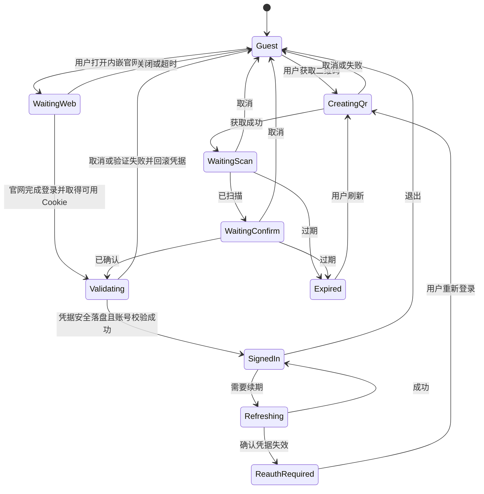

# API、鉴权与数据边界

2026-11-24 课程（PUGV）以 Web Cookie 读取 `api.bilibili.com` 的 JSON 接口。`GET /pugv/view/web/season` 接受 `ep_id` 或 `season_id`，返回课程、章节及课时目录；`GET /pugv/player/web/playurl` 使用 `ep_id/cid/qn/fnver/fnval/fourk` 获取可播放的 DASH 音视频分轨。两者无 WBI、CSRF 或客户端翻页，沿用 25 秒总期限、账号 epoch、取消与有界读重试。课时时长以秒计，目录保留不可播项。每一课时的评论用 `oid=课时 ID, type=33`。登录账号沿用原有心跳设置和单次 CSRF POST，课程使用 `type=10, aid, cid, epid, sid`。课程与影视详情分开缓存，本地 SQLite v4 为课时新增可空列。

协议对照本地 PiliPlus `217fb54f51f6764176319bbdedab2a7522d75401` 的 `lib/http/search.dart`、`lib/http/video.dart`、`lib/models/common/video/video_type.dart` 和 `lib/pages/video/reply/controller.dart`。本项目独立实现 Web PUGV 接口与页面，复用已有播放器。[公开样本](https://www.bilibili.com/cheese/play/ep20766) 的游客目录含 603 节，其中 3 节可试看。Windows 已验证首节 146 秒源的音视频解码及进度推进。已购账号、线上账号写入和移动设备播放尚未实测。

2026-11-16 App 推荐继续使用 GET `app.bilibili.com/x/v2/feed/index`，改为显式 flush／pull 场景与服务端首卡锚点，采用与现有 HD 凭据一致的 query／UA／签名。Android 读取公开型号、系统及网络事实；其他平台使用固定参考。推荐 trackid 经内存上下文传到既有 Web 播放心跳的 track_id／from_spmid，不增加端点或写请求次数。协议与验证见[请求和归因修正](validation/app-recommendation-alignment-2026-11-16.md)。

2026-11-15 PGC 沿用 `GET https://api.bilibili.com/pgc/player/web/playurl` 的 Web Cookie profile、`ep_id/qn/fnver/fnval/fourk/module/voice_balance` 参数、JSON `result`、有界只读重试、总 deadline 和取消／epoch；无新增签名、CSRF 或分页。增加可选 `clip_info_list` 元数据解析：`CLIP_TYPE_OP/ED`、以秒计的 `start/end`，转换为毫秒后检查源时长与正向区间，最多 64 项。未知／非法项和缺失列表不阻塞播放，试看不启用整集跳过数据。官方与空降优先级、精确参考提交及在线样本见[PGC 跳过记录](validation/pgc-skip-segments-2026-11-15.md)。

2026-11-15 密码／短信登录接入 App Passport：RSA 密码、App 短信、极验与安全中心手机号验证，成功后由 SessionRepository 校验并原子保存 Cookie／App token。具体 method、签名、端点和重试边界见[密码／短信 App 登录](validation/password-sms-app-login-2026-11-15.md)。明确的官网登录仍可保存 Web-only 会话，已有会话不自动转换。

同日安全中心 captcha/pre 单独使用无 Cookie／签名及 App buvid 的 Web 注册上下文，并校验 recaptcha_type；实测携带 App buvid 返回第四代注册，不能交给第三代 fullpage。安全中心短信及授权码交换仍使用 App 签名；来源、在线对照及验证见上述记录。

2026-11-12 番剧、国创与放映厅接入 Web Cookie GET `/pgc/view/web/season/user/status` 及 CSRF 单次 POST `/pgc/web/follow/add`、`/del`。状态按季编号共享，账号／epoch／取消隔离，写入结果不明须读取核对，来源与验证见[PGC 追番](validation/pgc-follow.md)。

2026-11-11 共享请求管线补齐 Web 设备上下文、安全持久化、风控／验证码识别与端点冷却；热门精选增加 WBI 和页面上下文。业务拒绝不自动重试，账户写入继续单次提交；协议、PiliPlus 来源、离线回归与线上未验收边界见[请求风控](validation/api-risk-control-2026-11-11.md)。

2026-11-11 动态增加管理和应用内投票：Web Cookie／CSRF 单次删除、置顶、可见性、互动和举报，WBI 单次编辑，Web IM 卡片分享与投票参与；游客可见性检查使用独立空 CookieJar。端点、容量、账号隔离与验证见[动态操作菜单与投票](validation/dynamic-operations-and-voting-2026-11-11.md)。

2026-11-11 动态投票补齐 Web GET `/x/vote/vote_info` 与 JSON POST `/x/vote/do_vote`，复用 Cookie／CSRF、25 秒 deadline 和单次写入通道。卡片及正文保留投票身份，在应用内查看和参与；服务端选项索引、本人选择、账号隔离及结果不明处理见[动态投票查看与参与](validation/dynamic-poll-viewing-2026-11-11.md)。

2026-11-11 动态投稿补齐B站表情、@用户、18图、标题／评论／私密／定时设置及投票／直播预约。新增 Web Cookie 用户候选读取、单次投票JSON与预约form创建，富文本保留type及biz_id；附件创建不明与动态创建不明共用显式核对锁定。端点、参数、容量及验证边界见[动态发布能力](validation/dynamic-publishing-parity-2026-11-11.md)。

2026-11-08 我的关注增加 Web Cookie 全量搜索（WBI `/x/relation/followings/search`）、黑名单分页、关注排序及分组新建／重命名／删除／排序。写入沿用 Web Cookie／CSRF 单次提交，结果不明需刷新，管理端口只允许本人账号。端点、字段、取消与验证边界见[关注／粉丝卡片与管理](validation/profile-relations-2026-11-08.md)。

2026-11-05 空间反馈修复复用 `api.bilibili.com` Web JSON 端点：基本资料 GET `/x/web-interface/card` 增加 `photo=true`，解析响应中的 `space.l_img/s_img` 作为头图；GET `/x/space/setting?mid=...` 读取 `privacy.fav_video/bangumi`，区分收藏夹及追番／追剧隐藏状态，本人查看不受访客隐私限制。两项读取 Cookie 可选，无签名、CSRF 或分页，沿用取消、25 秒总 deadline 与有界只读重试。黑名单状态使用当前 Web Cookie GET `/x/relation?fid=...`，无签名、CSRF 或分页；显式确认后 POST `/x/relation/modify`，字段 `fid/act=5或6/re_src=11`，使用当前 Web Cookie／CSRF，仅尝试一次。账号 scope/session epoch 及页面生命周期隔离迟到结果；细节、参考与线上未验收项见[空间修复](validation/profile-fixes-2026-11-05.md)。

同日按用户要求将主页举报改为应用内表单，显式点击提交后单次 form-urlencoded POST `https://space.bilibili.com/ajax/report/add`，Web profile、目标域 Cookie/CSRF，参数 `mid/reason` 和可选 `reason_v2`；不需要签名、App token 或分页。响应严格检查旧式 JSON 布尔 `status`，保留认证/风控 `code` 错误；账号 epoch、取消、25 秒总 deadline 和写入不重试沿用共享通道。参考、编码、结果不明处理和真实账号未验收边界见[应用内举报](validation/profile-report-2026-11-05.md)。

2026-11-05 主页补充五个 `api.bilibili.com` Web JSON 只读 GET：`/x/space/wbi/acc/info`（`mid/platform=web/web_location=1550101/token`，WBI，空间 Referer/Origin 和桌面浏览器 UA，无分页）、`/x/polymer/web-space/seasons_series_list`（`mid/page_num/page_size=10`，合集/系列目录）、`/x/polymer/web-space/seasons_archives_list`（`mid/season_id/page_num/page_size=30/sort_reverse=false`）、`/x/series/archives`（`mid/series_id/pn/ps=30/sort=asc`）和 `/x/space/bangumi/follow/list`（`vmid/type=1或2/pn/ps=30`，追番/追剧）。除资料端点外无签名；Cookie 可选，无 CSRF/App token，分页依据服务端 total，空页停止。均沿用 ApiRequests 的 25 秒总 deadline、账号 epoch、取消和有界读重试；风控不自动重放，资料失败不阻塞基本用户卡。公开合集与追番/追剧读取通过，扩展资料游客请求返回 `-352`；协议与未验收边界见[主页重构方案](ui-redesign/profile-redesign-2026-11-05.md)。

2026-11-05 消息第二轮扩展 Web IM 表情面板、`biz=im` 图片上传、内容推送／消息设置、屏蔽词、黑名单和举报。通知回复严格使用 `business_id/subject_id/source_id/root_id`，复用现有评论写端点。批量已读为用户确认范围内逐会话 `update_ack`，`ack_sessions` 仅同步已读变更；全部写入保持单次执行、账号／取消／deadline 隔离。端点与未验收边界见[消息表情、发送与管理入口](validation/messages-rich-composition-2026-11-05.md)。

2026-11-05 消息管理新增 Web Cookie JSON 响应的三个单次 form-urlencoded POST，host 为 `api.vc.bilibili.com`：`/session_svr/v1/session_svr/set_top`（`talker_id/session_type=1/op_type`，0 置顶、1 取消）、`/link_setting/v1/link_setting/set_msg_dnd`（`uid/dnd_uid/setting`，1 开启、0 关闭）和 `/session_svr/v1/session_svr/remove_session`（`talker_id/session_type=1`）。均复用固定目标域 Cookie/CSRF、25 秒总 deadline、取消/epoch 与写请求不重试，不需要 App token，无分页。官方公开脚本核对到路径和参数，不等于真实账号写操作已验收；消息富内容、来源与测试见[消息中心重构](validation/messages-redesign-2026-11-05.md)。

2026-11-03 会员弹幕复用现有 Web Cookie／CSRF 单次写端点 `POST https://api.bilibili.com/x/v2/dm/post`，请求为 form-urlencoded；会员样式增加 `colorful=60001` 并使用白色底色，普通样式省略该字段。读取仍走现有 HTTP Protobuf 分段，解析字段 24；权益提示来自会话验证的 `/x/web-interface/nav`。不新增重试或分页规则，写结果不明时不自动重放；字段、来源和真实账号未验收边界见 [专项记录](validation/vip-danmaku-2026-11-03.md)。

2026-11-01 UGC 主播放参考 PiliPlus 补齐 WBI 签名前的 `fnver=0` 和 Web 播放上下文，仓储先请求 `qn=129` 再按实际 DASH 应用画质／编码偏好，必要时有界补取缺失的较低档位。保留语音参数、账号／取消隔离和完整音视频分轨要求；协议对照、在线证据及大会员 1080P60 未验收边界见[专项记录](validation/playurl-quality-2026-11-01.md)。

2026-10-31 App 推荐响应接纳规则与 PiliPlus `c741279080fa90571d59ff9558640beb88861492` 对齐：保留已一致的完整请求参数，排除指定广告类型、有广告信息及不可播放卡片，不再仅接纳 av。原始 card_goto／param 分别用于导航与反馈，非 av 不将 param 当作 AV aid；番剧沿用现有影视路由，动态及允许的内容链接沿用外链端口，未知类型保留卡片并提示。字段有效性、容量限制、用户过滤、账号隔离与单次写入不变，详见[App 推荐设计](app-recommendation-design.md)。

2026-10-31 App 推荐请求与本机 PiliPlus 固定快照对齐完整 Android HD UA、feed 指纹占位请求头和新设备 buvid 格式；保留已有设备标识及账号凭据，指纹头仅用于首页 App feed，不采集硬件标识。来源、协议字段和兼容边界见[App 推荐设计](app-recommendation-design.md)。

2026-10-28 登录由 SessionRepository 统一提交，安全快照 version=2 的 App 凭据可选；HD 扫码同时取得 Cookie/token，内嵌官网密码/短信只保存通过 nav 验证的 Web Cookie。已删除实测失败的 Cookie 换 token 路径，旧 version=1 仍可恢复。App 推荐无 token 时使用游客身份，有效同账号 token 才用于账号推荐；设置仅显示当前身份摘要。两条登录路径、取消/回滚及验证见[统一登录](unified-login-design.md)。

2026-10-27 推荐流过滤解析 Web 推荐、热门/排行/分区、相关视频响应中的可选 `stat.like`、`tname`、`is_followed`，在应用层按偏好筛选。新增可选 App 推荐 profile、独立 buvid 与扫码授权，游客可直接读取，统一登录取得的 token 只用于对应 Web 账号的 App 推荐/反馈；默认仍为 Web。aid 本地转换为 bvid，不增加逐视频请求。App 关注豁免只额外识别精确“已关注/新关注”，不从含糊推荐理由猜测点赞数。端点及离线/在线验证边界见[App 推荐设计](app-recommendation-design.md)。

2026-10-25 热门收敛为综合热门、每周必看、入站必刷、排行榜四子标签。新增 Web 期数目录、单期与入站单份列表；排行榜沿用动态官网 UGC 分区及 WBI，综合热门保留原分页。官方脚本、三个参考仓库精确提交、端点/容量/取消规则和游客单期 `-352` 未验证边界见[热门四子标签](validation/popular-tabs.md)。

2026-10-11 普通视频与影视播放请求加入 `voice_balance=1`，解析可选 `volume` 响度元数据；鉴权、选流与权益边界不变。请求 profile、字段校验及在线抽样限制见 [播放器音量均衡](validation/audio-normalization.md)。

2026-10-10 UGC 充电专属／付费权益沿用详情与 WBI 播放链路接入；缺少完整轨道时区分观看权限，列表保留明确分类并显示共用角标。字段、端点、试看边界和真实账号未测项见 [充电专属与付费视频](validation/video-access.md)。

期期：2026-10-05。本文定义目标契约；表中的接口来自本地参考代码，尚未对在线 Bilibili 服务验证。

## 1. 从 bili-kernel 借鉴什么

`bili-kernel` 是 .NET API 包装器，不是 Rust 内核。借鉴其 `Abstractions → Services → Core/Authenticator/Http → Resolvers` 的职责拆分、统一模型和取消能力。在 Dart 中重建这些边界，不通过 .NET 运行时桥接，也不把源码目录整体复制为依赖。

`bili_api` 的目标结构：

```text
lib/src/
├── transport/          # Dio HTTP、可选 gRPC、WebSocket 传输
├── endpoints/          # host、path、method、auth、响应格式、重试/能力策略
├── auth/               # SessionProvider、Cookie、CSRF、WBI、设备上下文
├── clients/            # AuthClient、CatalogClient、PlayerClient、LiveClient 等
├── models/             # 公共 Api* 类型；不含 Flutter 类型
├── dto/                # 内部 JSON/Protobuf 数据结构
├── mappers/            # 协议 DTO -> Api* 类型
├── codecs/             # 直播包、Protobuf、压缩
└── errors/             # ApiFailure、TransportFailure、ProtocolFailure
```

公共入口显式导出支持的类型，不让调用方导入 `src/`。主应用 Repository 在这里之上处理缓存、离线、产品领域模型；API 包不负责 UI 提示。

## 2. 协议优先级

2026-11-01 搜索发现新增公开只读 Web JSON：`GET https://api.bilibili.com/x/v2/search/trending/ranking?limit=10`，Cookie 可选、无签名/CSRF/App token、无分页；沿用有界读取重试、25 秒总 deadline、取消与账号 epoch。解析 `data.list` 的展示名与真实关键词，进程内缓存成功结果 5 分钟；历史按账号保存在本机，未做在线端点烟测。参考、容量、布局和测试见[搜索历史与热搜](validation/search-discovery-2026-11-01.md)。

同日补充搜索联想：`GET https://api.bilibili.com/x/web-interface/suggest`，Cookie 可选、WBI 签名，无 CSRF／App token／分页；`term` 配合 `highlight=0`、`spmid=333.1365`、`web_location=333.1365`。解析 `data.result.tag[].term`，有界去重至多 10 条；输入 300 ms 防抖，清空、关闭和账号变化取消旧请求，复用 25 秒 deadline 与协议层有界只读重试，Provider 不叠加自动重试。协议来源与离线验证见[专项补充](validation/search-discovery-2026-11-01.md#issue-50-搜索体验补充)，未做在线响应验收。

2026-10-31 新增 TV 投屏只读端点：`GET https://api.bilibili.com/x/tv/playurl`，App profile MD5 签名，游客可请求，已有且未过期的 App token 同时用于 `access_key`／`mobile_access_key`，不携带 Web Cookie。`object_id` 为 UGC aid 或 PGC episode ID，`cid` 保留真实内容身份，`playurl_type` 分别为 1／2；`is_proj=1`、`protocol=0`、`fourk=1`，清晰度沿用本地已选值。无分页；单次总预算 25 秒内最多两次只读尝试，取消／账号 epoch 隔离沿用 `ApiRequests`。JSON 仅接受一个完整 `durl` 段，不将 DASH 单轨或试看作为完整投屏成功。设备发现和 SOAP 操作独立于账号 HTTP 通道，写命令不自动重放；详情见 [DLNA 投屏](validation/dlna-casting.md)。

2026-11-13 直播投屏复用现有 `LiveClient.getPlayInfo` 和 WBI 请求上下文，按规范房间 ID／开播状态交接，普通设备选择 AVC HLS／FLV 签名地址。声明 B站服务的接收端只接收内容身份与播放／弹幕偏好，自行使用电视账号取流；点播不再要求先取得 TV `durl`。局域网 SOAP 元数据不携带 Cookie、App access／refresh token，不新增账号转换、远端授权或自动写请求重试。

2026-11-14 纠正上述自动取流分流：默认对包括云视听在内的所有设备保留 TV `durl`／直播媒体地址解析。仅用户主动开启“电视弹幕（实验）”且设备声明 B站服务时才跳过直链，不能因发现服务就假定接收端版本／专有取流会话兼容；不新增接口、鉴权转换或自动写请求回退。见[回归修复](validation/casting-compatibility-regression-2026-11-14.md)。

MVP 优先 **Web REST + Web Cookie + 按端点配置 WBI/CSRF**，视频弹幕使用 HTTP 返回的 Protobuf，直播消息使用 WebSocket。收到 Protobuf 字节并不意味着必须使用 gRPC。

App/TV token 按功能独立接入，gRPC 仍延后。App 推荐可使用游客身份；个性化推荐和反馈只使用正常登录取得的 App token。参考项目的 App/TV 参数不能直接与 Web Cookie 登录拼接，缺少 token 不允许提交 App 反馈。

| 通道 | MVP 策略 | 原因 |
| --- | --- | --- |
| Web REST / JSON | 主通道 | 先完成 Cookie 登录、搜索、详情、播放链路 |
| HTTP / Protobuf | 点播弹幕必需 | 元信息和分段解码，生成最小 schema |
| WebSocket / 二进制包 | M3 直播必需，M0 提前验证 | 分离聊天室连接与媒体播放 |
| gRPC | 延后，缺少 Web 能力时评估 | 多一套 metadata、token、压缩与 schema 维护 |
| App/TV REST | App 推荐及其扫码授权已接入，独立 profile | 游客只读烟测与登录/反馈实测分别记录；其他 App 能力继续按需评估 |

## 3. 请求契约与流水线

以下是设计示意，尚不是可直接编译的 Dart API：

```dart
EndpointSpec {
  id, host, path, method,
  profile,                 // web / app / tv
  authPolicy,              // guestAllowed / cookieOptional / cookieRequired / appTokenRequired
  signingPolicy,           // none / wbi / appSign
  csrfPolicy,              // none / required，含具体参数名与位置
  responseFormat,          // json / protobuf / binary
  retryPolicy,             // readOnlyBounded / noAutomaticRetry
}

RequestContext {
  accountScope, sessionEpoch, deadline, cancellation, operationId
}

ApiPage<T> { items, nextCursor, hasMore }
```

流水线：校验输入 → 固定会话快照 → 检查端点能力 → 准备设备/Cookie → 获取签名上下文 → 对最终参数签名 → 发请求 → 校验 HTTP/业务状态 → 解码 DTO → 转为 `Api*` → Repository 形成领域结果。

- 参数保留未编码值，到 transport 边界只编码一次。排序、空格、中文、特殊字符和时间戳有固定样例测试，不能照抄参考代码中的字符串拼接。
- `ApiSessionProvider` 只向 auth/transport 提供必需的凭据快照；调用方拿到 `SessionSummary`，没有 Cookie/token 明文。
- 超时分连接/响应/总 deadline；取消信号传到网络、解析队列和 Repository，取消不是需要 toast 的失败。
- 每个重试周期固定账号；会话改变即取消。签名需要新时间戳时重签最终参数，不能重复发送已过期的签名。
- 长 ID 用领域值对象承载，边界序列化为十进制字符串；Protobuf int64 转换时校验范围，避免通过浮点数转换。

## 4. 接口能力映射

来源缩写：K = `bili-kernel/src`，U = `biliuwp-lite/src/BiliLite.UWP`。具体可点击入口见 [参考映射](references.md)。下表是迁移定位清单，不是在线成功清单；尤其播放、历史、动态中的 Web/App 差异要逐项验证。

| 能力/阶段 | 参考端点或方法 | 源码入口 | Flutter 归属及验证点 |
| --- | --- | --- | --- |
| 扫码登录 M0/M2 | `/x/passport-login/web/qrcode/generate`、`/poll` | U `Models/Requests/Api/AccountApi.cs` | AuthClient；Web 二维码与 Set-Cookie，取消/过期/确认 |
| 密码/短信登录（提前实现） | 内嵌 `https://passport.bilibili.com/login`；应用调用 `/x/web-interface/nav` 验证 | U AccountApi、LoginVM、LoginDialog；dart_simple_live Web 登录页 | Platform WebView → 会话控制器；保留 Cookie 作用域、账号校验和安全存储；不在 API 包维护官网表单 POST；见 [登录验证](validation/password-sms-login.md) |
| 统一 Web/App 扫码登录 | `passport.bilibili.com` POST `/x/passport-tv-login/qrcode/auth_code`、`/poll` | PiliPlus `lib/http/login.dart` | HD profile/签名，不带 Cookie；用户点击后有界轮询，成功同时返回 token 和 Cookie，经 nav 验证后一起保存 |
| 会话与 WBI M0/M2 | `/x/web-interface/nav`、cookie info/refresh/confirm | K `BiliKernel.Abstractions/Bili/BiliApis.cs`、Core Authenticator；U AccountApi | SessionStore；刷新要取得所需 refresh 数据，缺失则重新登录 |
| 推荐 | Web `/x/web-interface/index/top/feed/rcmd`；桌面端 `/x/web-interface/wbi/index/top/feed/rcmd`；App `app.bilibili.com` GET `/x/v2/feed/index` | K VideoDiscoveryClient；PiliPlus `lib/http/video.dart`、[PR #3463](https://github.com/bggRGjQaUbCoE/PiliPlus/pull/3463) | Web/桌面端为 `api.bilibili.com` GET、可选 Web Cookie、WBI 签名；桌面端 `plat=1`、`feed_version=V1`、`ps=30`、`fresh_type=0/3/4`，从 0 开始的独立采样序号；App 签名、稳定 buvid、可选 access_key，idx 从 0 开始、首请求 pull=true；25 秒总 deadline、读最多三次、2 MiB/100 卡片、双空页预算；失败页显式重试复用采样序号，不重放反馈写入 |
| App 推荐反馈/撤销 | `app.bilibili.com` GET `/x/feed/dislike`、`/x/feed/dislike/cancel` | PiliPlus `lib/http/video.dart`、`video_popup_menu.dart` | token 必需；使用服务端 three_point_v2 的 reason_id/feedback_id，撤销携带 aid/goto；虽为 GET，仍按单次写入处理，未知结果不重放 |
| 热门/排行 | `/x/web-interface/popular`、`popular/series/list`、`popular/series/one`、`popular/precious`、`ranking/v2` | 官网热门脚本；PiliPlus VideoHttp；U RankAPI；K VideoDiscoveryClient | Web 综合热门分页、每周期数选择、入站及榜单单份列表；不混用 App gRPC 或旧 newlist 分区，见[协议记录](validation/popular-tabs.md) |
| 搜索 M2 | `/x/web-interface/wbi/search/type`、`/all/v2` | K `Services/Services.Search/Core/SearchClient.cs` | SearchClient；WBI、Cookie、排序及分页 |
| 视频详情 M0/M2 | `/x/web-interface/view/detail`、`GetVideoPageDetailWithRestAsync` | K `Services/Services.Media/Core/PlayerClient.cs` | VideoRepository；bvid/aid 解析、cid、分 P、合集 |
| 消息评论定位 | `GET https://api.bilibili.com/x/v2/reply/jump`，`oid/type/rpid`；再按返回 `rt_num` 直接读取 `/x/v2/reply/reply` | PiliPlus `DetailList(root,rpid)` 的交互职责、官方 Web 只读样本（独立实现） | 可选 Web Cookie，无 WBI／CSRF；两次逻辑读取共享 15 秒总期限与账号／epoch；有界读重试，无扫描或 500 条定位限制，见 [消息定位](validation/message-content-navigation-2026-11-14.md) |
| 评论视频链接 M2 | `GET https://b23.tv/<path>`；`GET https://api.bilibili.com/x/web-interface/view?aid=…` | U `MessageCenter.HandelUrl`、`BiliExtensions.GetShortLinkLocation` | Comments application → CommentVideoLinkRepository；短链无鉴权/签名，读取 Location，不解析正文、不重试；AV 转 BV 为 Web JSON、可选 Cookie、无签名，复用 API 有界读重试（最多 3 次）；均无分页、总解析期限 8 秒，见 [评论验证](validation/video-comments.md) |
| 视频标签 M2 | `/x/tag/archive/tags` | U `Models/Requests/Api/VideoAPI.cs`、VideoDetailPageViewModel | VideoExtrasRepository；独立只读、BV 身份隔离和点击关键词搜索，见 [视频标签与搜索](validation/video-tags.md) |
| 视频播放 M0/M2 | `/x/player/playurl`、`GetVideoPlayDetailWithRestAsync` | K PlayerClient | PlaybackResolver；参考调用混有 App 参数，须独立验证 Web profile |
| CDN 测速样本 | `api.bilibili.com` GET `/x/player/wbi/playurl`（现有 preview profile，`qn=32`） | Web/WBI，复用现有会话／签名；公开视频，无分页 | CdnSpeedTestRepository；既有读重试／25 秒 deadline，关闭与账号 epoch 取消；不创建播放器或上报历史 |
| CDN 测速片段 | 样本视频轨及所选已知镜像 GET `Range: bytes=0-1048575` | 公开 Referer/User-Agent，无 Cookie/token | 串行、不重试、每地址 1 MiB／5 秒、最多 3 次重定向，脱敏失败；[规则与验证](validation/video-cdn.md) |
| 字幕/章节附加信息 M2 | `/x/player/wbi/v2` | K `Services/Services.Media/Core/SubtitleClient.cs` 与 PlayerClient；PiliPlus `view_points` 字段 | PlaybackMetadataRepository；合并一次 WBI 读取，字幕/章节故障独立；见 [实现验证](validation/playback-timeline.md) |
| 互动视频 | `api.bilibili.com` GET `/x/player/wbi/v2`（`bvid/cid`）与 `/x/stein/edgeinfo_v2`（`bvid/graph_version`，分支另带 `edge_id`） | PiliPlus 控制器与公开游客响应 | Web JSON，只读，无分页。可选 Cookie，剧情版本请求使用 WBI 签名，节点请求无需签名。取消、失败和样本见 [互动视频](validation/interactive-video.md) |
| 视频正在观看人数 | `api.bilibili.com` GET `/x/player/online/total`；`bvid/cid` | UWP `PlayerAPI.GetPlayerOnline`／`PlayerVM.GetOnline` 与本机游客响应 | Web Cookie 可选，无签名；JSON `total/show_switch.total`，无分页；共享 deadline 和至多 3 次读尝试，页面可见时 30 秒刷新；见 [顶部导航与人数](validation/player-top-navigation.md) |
| 高能趋势（公开只读） | `bvc.bilivideo.com` GET `/pbp/data`；`aid/cid/bvid/r=loader` | 2026-10-11 官网实际游客请求 | 不带 Cookie/WBI；`modules` 包装；6 秒总 deadline、至多 2 次网络尝试；流式 256 KiB 解压后上限；确认无章节后读取，失败普通进度条；见 [实现方案](high-energy-progress-design.md) |
| 视频悬停缩略图 M2 | `/x/player/videoshot` → `pvdata` CDN 二进制 | 官网大端 uint16 时间索引；来源/采用范围见 [实现验证](validation/playback-timeline.md) | PlaybackMetadataRepository；移入／拖动懒加载，失败在新交互补试、每步单次请求，共用 deadline／epoch；索引上限 40002 字节、公开 CDN 无凭据 |
| 视频弹幕 M0/M2 | `/x/v2/dm/web/view`、`/x/v2/dm/web/seg.so` | K `Services/Services.Media/Core/DanmakuClient.cs` | DanmakuRepository；Protobuf、分段数、毫秒进度、空分段 |
| 直播播放 M0/M3 | `/xlive/web-room/v2/index/getRoomPlayInfo` | K PlayerClient；PiliPlus LiveHttp | Web GET、Cookie 可选、WBI 签名；protocol=0,1、format=0,1,2、codec=0,1,2、ptype=8、dolby=5、panorama=1、web_location=444.8；真实 roomId、组合／线路与 current_qn，见[直播流偏好](validation/live-stream-audio-preferences-2026-10-30.md) |
| 直播卡悬停预览 | `api.live.bilibili.com/xlive/web-room/v2/index/getRoomPlayInfo` | 官方直播首页当前脚本，独立读取配置 | Web GET、Cookie 可选、不加 WBI／CSRF；room_id、no_playurl=0、mask=1、qn=0、platform=web、protocol=0,1、format=0,1,2、codec=0,1、special_scenario=2；JSON，无分页，沿用 API 总次数／deadline；只在有效悬停时请求，移开或账号 epoch 改变取消，最多打开三个服务端媒体地址；见[实现与验证](validation/live-card-hover-preview-2026-11-14.md) |
| 直播消息 M0/M3 | `/xlive/web-room/v1/index/getDanmuInfo`、EnterLiveRoomAsync | K PlayerClient | LiveChatSession；token/host、鉴权、分包/合包、心跳 |
| 直播 SC M3 | `/av/v1/SuperChat/getMessageList` | U `LiveRoomAPI.RoomSuperChat` | Web GET、Cookie 可选、无签名；LiveRepository 读取快照，20 秒有界刷新与本地过期清理 |
| 直播在看人数 M3 | `/xlive/general-interface/v1/rank/getOnlineGoldRank` | GitHub qydysky/biliApi + 本机游客响应 | Web GET、Cookie 可选、无签名；独立精确 `onlineNum` 快照、20 秒可见页面刷新；不从人气或累计看过补值，见 [人数精度](validation/live-viewer-precision.md) |
| UP 空间直播入口 M3 | `/room/v1/Room/getRoomInfoOld` | U `LiveRoomAPI` / `UserInfoPage` | Web GET、Cookie 可选、无签名；以 `mid` 独立查询 `roomStatus`／`roomid`／`liveStatus`，见 [入口验证](validation/profile-live-entry.md) |
| 收藏/稍后再看 M3 | `/x/v3/fav/resource/list`、`/x/v2/history/toview` | K `Services/Services.User/FavoriteService.cs`、Core/MyClient、Core/ViewLaterClient | LibraryRepository；账号隔离、分页、删除操作反馈 |
| 历史/进度 M2/M3 | `/x/v2/history/report`、GetHistory 类接口 | K `Services/Services.User/Core/ViewHistoryClient.cs`、PlayerClient | 本地续播 M2；云读取/上报 M3，先核验 Web 或独立 App 通道 |
| 评论 M3 | CommentClient 中的读取及写入方法 | K `Services/Services.Comment/Core/CommentClient.cs` | CommentRepository；root/rpid、游标，先读后写 |
| 评论发送扩展 | Web `mention/search`、`upload_bfs`、`reply/add` | PiliPlus 指定提交的发布页与 HTTP 字段 | 共享 CommentsController；@映射、图片 multipart 单次上传、显式同步动态，见 [协议与验证](validation/comment-composer-2026-10-31.md) |
| 动态/用户 M3 | MomentClient、MyClient、RelationshipService | K Services.Moment、Services.User | 各模块单独登记可用协议，MVP 不承诺完整 gRPC 迁移 |
| 动态 UP 主筛选 | Web `portal`、`uplist`、`feed/all` 的 `host_mid` | PiliPlus `4fce4bb5a35c425aee759ef9263352316a29e355` HTTP 动态接口及官网脚本 | Cookie JSON 只读，目录／内容游标独立、账号与工作区隔离，见 [协议与验证](validation/dynamic-author-filter-2026-11-08.md) |
| 应用内话题页 | Web `/x/topic/web/details/top`、`/x/polymer/web-dynamic/v1/feed/topic`、`/x/topic/web/details/fold` | PiliPlus 同一固定提交的话题页、HTTP 端点与模型 | 简介使用 `app.bilibili.com` 的单路径白名单，动态／折叠使用 `api.bilibili.com`；Cookie JSON 只读、服务端排序／游标、500 条上限及会话隔离，见[话题协议登记](validation/dynamic-topics-and-text-2026-11-09.md) |
| 动态发布与话题操作 | Web `topic/pub/search`、`upload_bfs`、`create/dyn`、`topic/fav/sub/*`、`topic/report` | PiliPlus 同一固定提交的发布／话题页面及官方 H5 举报脚本 | 具体 host/path 白名单；文字／图片／话题草稿、显式单次写、结果不明锁定与账号隔离，见[协议和验证](validation/dynamic-publishing-and-topic-page-2026-11-10.md) |
| 动态分享/评论/点赞（提前实现） | Web `/x/dynamic/feed/dyn/thumb`、`/x/dynamic/feed/create/dyn`，复用 `/x/v2/reply/*` | U DynamicAPI / 动态详情；K MomentAdapter / CommentTargetType；官网动态 Web 脚本 | 独立 DynamicRepository、共用 CommentsRepository；按 basic 评论身份隔离，JSON query CSRF 单次写，见 [动态交互登记](validation/dynamic-interactions.md) |
| 账号摘要与消息（提前实现） | `/x/web-interface/nav/stat`、`/x/msgfeed/*`、VC 会话/私信、`/x/sys-msg/query_user_notify` | U HomePage、MessageApi；K MessageService、MyClient | AccountClient/MessageClient；Web Cookie、十进制游标、CSRF 单次写、账号隔离；见 [实测登记](validation/account-messages.md) |
| PGC M4 | GetPgcPageDetailAsync / GetPgcPlayDetailAsync | K PlayerClient、PgcClient | PgcRepository；season/episode、权益和区域结果 |

每个实际接入的端点必须记录：host/method、参数、profile、鉴权/签名、脱敏响应 fixture、最后验证期期、失败码、降级策略。文件名中出现 Web 或 BiliApis 常量存在都不足以证明某种登录态能使用它。

2026-10-09 已接入字幕 AI 字段和在线点播语音选择：字幕 `type=1` 表示 AI，`ai_type=0/1` 区分普通识别/翻译；合法空文本 cue 被跳过，协议损坏仍失败。WBI GET `/x/player/wbi/playurl` 的 `language.items` 提供语音能力，使用 `cur_language`、`cur_production_type` 和 `client_attr=1` 重新签名请求；Repository 校验回传语言，PlaybackSession 复用完整 DASH 双轨切换。英、日语音、恢复原声及实际菜单已通过登录态 Windows 原生验证。新版 GET `/x/v2/subtitle/web/view` 是 Web Cookie HTTP Protobuf，仍仅用于独立调查；生产字幕沿用 `/x/player/wbi/v2` 和 JSON 正文。端点、字段、样本与接入边界见 [字幕与 AI 原声翻译](validation/subtitles-translated-audio.md)。

我的收藏现有五类子标签和主页收藏视频读取，仍由现有 HomeRepository/ProfileRepository 编排。自建收藏夹元信息与编辑由 FavoriteFolderRepository 编排，Web Cookie/CSRF 单次提交，未知结果通过读取核对。默认收藏夹 ID、收藏/订阅合集类型、Web 追番/追剧、私密/创建日期及读写验证边界见 [收藏子标签与视频卡片](validation/favorites-tabs.md)。

2026-11-20 收藏夹内搜索与排序复用 Web profile 的 `api.bilibili.com` HTTPS GET `/x/v3/fav/resource/list`。请求传原始 `keyword`、`order=mtime/view/pubtime`、`tid=0` 和 `platform=web`。单夹使用 `type=0`，搜索我的全部视频收藏时使用服务端识别的默认收藏夹 ID 和 `type=1`。列表及其播放队列按同一条件分页，优先依据响应的 `has_more`。Cookie、取消、会话隔离、总 deadline 与读重试沿用现有管线。交互、协议来源及验证范围见[收藏夹搜索与排序](validation/favorites-tabs.md#收藏夹搜索与排序2026-11-20)。

“我的收藏与订阅”的卡片支持用户确认后取消普通收藏夹收藏或 UGC 合集订阅，分别使用 `/x/v3/fav/folder/unfav` 与 `/x/v3/fav/season/unfav` 的 Web Cookie/CSRF 单次 POST。写操作不自动重试，成功后隔离迟到列表响应并重新协调分页；协议、确认交互及未实测边界见 [收藏与订阅取消操作](validation/favorites-unsubscribe.md)。

2026-11-12 自有收藏夹内视频支持确认后取消收藏，使用 `/x/v3/fav/resource/batch-deal`，仅移除当前夹；自建收藏夹支持通过 `/x/v3/fav/folder/del` 删除。两者沿用 Web Cookie/CSRF 单次写入，重新校验拥有者，结果不明需刷新核对；端点参数、PiliPlus 固定来源和验证边界见 [收藏管理](validation/favorite-management-2026-11-12.md)。

推荐与稍后再看的视频卡标题菜单分别接入 Web POST `/x/web-interface/feedback/dislike`（内容不感兴趣，`reason_id=1`）与 `/x/v2/history/toview/del`（按 `aid` 删除），添加沿用 `/x/v2/history/toview/add`。反馈使用本次推荐响应的内容身份和 `track_id`，没有对应上下文时明确提示不可反馈。推荐反馈成功保留原卡片位置并显示遮罩，用户可显式调用 `/x/web-interface/feedback/dislike/cancel`，携带原成功反馈上下文；撤销确认成功才恢复卡片。稍后再看删除成功才移除卡片。四项操作只由明确点击触发，沿用 Cookie/CSRF、账号 scope/session epoch、取消与单次写入，未知结果不重放。端点参数、来源及实际验证边界见 [视频卡操作菜单](validation/video-card-menus.md)。

视频播放页合集标题接入订阅状态与显式订阅/取消，按当前视频 `aid`／`bvid` 读取 `/x/web-interface/archive/relation` 的布尔字段 `season_fav`，不扫描账号收藏列表；写操作仍为 `/x/v3/fav/season/fav`、`/x/v3/fav/season/unfav` 单次 POST。合集详情的公开响应没有 `fav_state`，但这不能证明其他接口没有订阅状态，官网关系接口与按钮逻辑的核对依据见 [合集订阅按钮](validation/collection-subscription.md)。已关注 UP 菜单增加设置分组，读取 `/x/relation/tags`、`/x/relation/tag/user`，保存至 `/x/relation/tags/addUsers`；见 [关注用户分组](validation/follow-groups.md)。两者沿用 Web Cookie/CSRF、取消与账号 scope/session epoch 隔离，真实账号写入待用户验收。

影视与直播已按用户本轮要求提前接入 Web 详情/播放/历史聊天；上述 M3/M4 定位仍是整体路线。实际已实现端点、取消与权限语义、游客烟测见 [影视与直播内置播放](validation/content-playback.md)。官方影视侧栏及 SC 快照端点、容量和前序验证见 [影视侧栏与直播 SC](validation/pgc-live-sidebar.md)。后续剧集弹幕/发送、直播实时连接与消息、SC 合并及当前分区列表协议见 [影视与直播弹幕修复](validation/pgc-live-danmaku.md)。

搜索接入七类 Web 搜索。默认综合首屏读取 `/x/web-interface/wbi/search/all/v2` 的混合模块与分类总数，视频条目及后续分页来自 `/x/web-interface/wbi/search/type?search_type=video`。综合页启用视频排序或筛选后从第一页起直接读取该视频接口，清除条件后恢复混合结果。分类标签继续显示当前关键词最近取得的未筛选计数。各分类原有端点及游客观测见 [搜索分类与排序](validation/search-categories.md)。

2026-11-20 搜索筛选继续使用 `api.bilibili.com` Web GET、WBI、可选 Cookie 及 JSON，沿用现有页码、账号隔离、请求取消和有界只读重试。综合／视频支持 `order=scores` 评论排序、`duration` 时长、`tids` 视频分区，以及 `pubtime_begin_s`／`pubtime_end_s` 发布日期。日期使用本地日历，发送起始日零点到结束日最后一秒的 Unix 时间戳。预设和自定义范围在应用筛选时确认，分页、刷新及重试复用同一参数。专栏分区使用 `category_id`，用户类型增加 `user_type=3` 认证用户。分类变化重置筛选，筛选变化取消旧请求并从第一页加载。

筛选字段只读核对 PiliPlus `217fb54f51f6764176319bbdedab2a7522d75401` 的 `lib/http/search.dart`、`lib/pages/search_panel` 和 `lib/models/common/search`。本项目独立实现筛选状态及请求映射。本轮新增字段由离线用例覆盖。游客抽查科技专栏分区返回 20 条结果，其余筛选未逐项在线验证。

2026-11-20 搜索专栏、历史专栏与动态中的专栏链接接入应用内阅读。以 CV 号打开时先向 `https://www.bilibili.com/read/cv{id}/` 发送不携带凭据的单次 HEAD，根据官方重定向识别迁移后的 opus ID。正文使用 `api.bilibili.com` 的 Web GET，WBI 签名、Cookie 可选、JSON 响应、无分页。旧专栏调用 `/x/article/view`，参数为 `id`、`gaia_source=main_web`、`web_location=333.976`。新版图文调用 `/x/polymer/web-dynamic/v1/opus/detail`，参数为 `id`、`timezone_offset=-480` 和 `features`。服务端明确返回旧专栏 ID 时可回读一次，本次读取共享取消、会话边界与总时限。

2026-11-21 增加专栏文集与互动。下列端点均位于 `api.bilibili.com`，返回 JSON。GET 允许游客访问、无分页，沿用 Web 读请求的取消、总时限和有界重试。POST 要求 Web 会话和 CSRF，每次用户操作发送一次。

| 能力 | 方法与路径 | 参数 |
| --- | --- | --- |
| 文集目录 | GET `/x/article/list/web/articles` | `id` 为文集号，`web_location=333.1400`，无 WBI |
| 专栏互动状态 | GET `/x/article/viewinfo` | CV 号 `id`、`mobi_app=pc`、`from=web`、`gaia_source=main_web`，WBI 签名；独立加载，个人点赞、收藏状态与公共计数分别读取 |
| 旧专栏收藏／取消 | POST `/x/article/favorites/add`、`/x/article/favorites/del` | 表单 `id`、`csrf`，无 WBI |
| 图文作品收藏／取消 | POST `/x/community/cosmo/interface/simple_action` | 查询 CSRF，JSON `entity.object_id_str` 为 opus ID、`entity.type.biz=2`、`action=3/4`，无 WBI |

2026-11-22 补充专栏迁移和历史文集身份。CV 地址的匿名 HEAD 没有返回有效作品地址时，读取 `/x/article/view`。校验返回的 CV 身份后，若 `opus.opus_id` 有效，使用它读取完整的新版正文，沿用同一 Web 会话、取消信号和总时限。新版端点明确回退至刚读取的 CV 时，复用该响应。集合历史的 `history.oid` 是文集号，`history.cid` 是阅读篇目的 CV 号，删除键继续使用根 `kid`。历史和搜索共用该字段解析。

动态点赞、转发与消息分享沿用现有协议，评论沿用响应指定的业务身份。交互和参考来源见[应用内专栏阅读](validation/article-reader-2026-11-20.md)。

2026-11-22 Web 私信发送使用 `api.vc.bilibili.com` 的 POST `/web_im/v1/web_im/send_msg`。沿用消息站 Origin／Referer、目标域 Web Cookie 和表单 CSRF，查询参数 `w_sender_uid`、`w_receiver_id`、`w_dev_id` 参与 WBI 签名，`w_dev_id` 与表单 `msg[dev_id]` 一致。文本、图片和分享卡片复用这条发送路径，响应为 Web JSON，无分页。密钥读取和发送共用账号／取消／总时限，发送只提交一次。专栏卡片使用 `msg_type=7`、`source=6`，携带 CV 号和正文标题。

### 评论菜单（2026-11-22）

共享评论区从列表的 `upper.mid` 确认 UP 主身份。评论作者和 UP 主可删除，只有 UP 主可置顶主评论。UP 主置顶状态来自 `reply_control.is_up_top`、`upper.top` 或 `top.upper`。菜单沿用评论所属业务的 `oid` 和 `type`，每次操作提交一次 Web Cookie / CSRF 表单，接收 JSON，无 WBI、分页或写重试。

| 操作 | api.bilibili.com POST 路径 | 表单 |
| --- | --- | --- |
| 删除 | `/x/v2/reply/del` | `oid`、`type`、`rpid`、`csrf` |
| 置顶／取消 | `/x/v2/reply/top` | 同上，`action=1/0` |
| 举报 | `/x/v2/reply/report` | 同上，`reason`、可选 `content`、`add_blacklist=false`、`platform=web`、`scene=main`、`gaia_source=main_h5`。其他及虚假不实信息须填写说明 |

交互与字段参考 PiliPlus `217fb54f51f6764176319bbdedab2a7522d75401` 的 `reply_item_grpc.dart`、`http/reply.dart`、`http/video.dart`、`common/widgets/dialog/report.dart` 和 `pages/save_panel/view.dart`。本项目独立实现菜单，通过图片导出服务保存含作者、正文、表情和配图的 PNG。Linux 使用保存对话框，iOS 使用“文件”可见的应用文稿目录。

在指定视频 `BV1nQxB6GEpd` 上使用本地 Windows Release 账号验证了发布、举报和删除。首次删除后查询得到 12006，稍后又读到了同一条自测评论。复核作者与唯一正文后，用“其他”及接口测试说明提交举报，服务端返回成功。再次清理该评论后，三次独立定位查询均未找到该 ID。另对原 UP 主置顶执行取消、回读、恢复和再次回读，最终置顶 ID 与初始一致。

## 5. 会话与凭据

普通视频云端进度使用 Web GET `/x/player/wbi/v2`；2026-11-09 修复影视续播，PGC 改读 GET `/pgc/view/web/season` 的 `user_status.progress`（`last_ep_id` 十进制 ID，`last_time` 秒），仅恢复匹配剧集的位置。两类点播继续 POST `/x/click-interface/web/heartbeat`：本地优先、云端仅在本地缺失时补充，上报使用已有 Web Cookie/CSRF，单次写入不重放，不使用参考实现的 App 签名。字段单位、容量、取消和验证边界见 [云端播放进度](validation/cloud-playback-progress.md)和[番剧续播修复](validation/pgc-resume-2026-11-09.md)。上表 `/x/v2/history/report` 保留参考源码定位，不是本项目的 Web 上报端点。

观看历史页面另由 `WatchHistoryClient` / `ApiLibraryRepository` 读取 Web Cookie GET `/x/web-interface/history/cursor`，使用服务端三字段游标分页，以视频详情补齐统计并显示观看日期。卡片菜单用 POST `/x/v2/history/delete` 按原始 `history.business + "_" + kid` 删除记录；顶部清空按钮经确认后用 POST `/x/v2/history/clear` 清空当前账号全部云端历史。两项写入均为 Web Cookie/CSRF 表单、JSON 响应，无 WBI/分页，单次提交不自动重试。该列表和写操作不改本地续播记录；端点、容量、来源和验证边界见 [云端观看历史](validation/cloud-watch-history.md)。

SC 快照 `time` 可为 `ts` 时刻的剩余秒数，实时事件的 `time` 通常为总时长；统一以 `end_time` 优先，在字段缺失时按来源补算。绝对到期计时与可见倒计时分开，重复消息不重置时长；字段与验证见 [直播 SC 时长与倒计时](validation/live-sc-lifetime.md)。

### 登录状态机



QR 轮询按服务端状态和间隔执行，只有一个活跃轮询；关闭弹窗、应用后台、二维码过期要停止或挂起。网络错误保留可恢复状态，不能自动无限刷新二维码。

Cookie 由 domain/path/secure/expiry 规则的 CookieStore 维护，持久化整个必要的作用域信息，不能只保存 `name=value` 字符串。接收 Set-Cookie 时检查来源域，限制跳转后的凭据发送；账号 Cookie 不发送到任意 CDN、字幕外链或外部浏览器。

会话刷新使用单飞：同一账号并发请求共享一次刷新，成功后仅按策略重放可安全重试的读请求。禁止每个 401 单独刷新；Bilibili 的业务码也可能表示失效，应经端点映射识别。密码／短信及验证码由内嵌官网完成，应用不持有表单字段、不保存密码、不自动提交登录写请求；只导入适用于 API 根路径的 Cookie，经 nav 校验后安全保存。账号验证有 25 秒 deadline，网页登录等待最多 10 分钟；网页等待允许用户切换应用查看短信，返回前暂停 Cookie 提取。协议与平台边界见 [登录验证](validation/password-sms-login.md)。

退出流程：递增 epoch → 取消账号请求/QR/WS/上报 → 停止依赖该账号的播放和下载 → 清理内存凭据与安全存储 → 清理私有缓存 → 进入 guest。离线文件单独询问用户是否删除，不能让普通退出自动破坏文件。

### WBI、CSRF 与设备上下文

- WBI key 由 nav 信息建立，缓存并记录取回时间；签名失败时只允许一次重新获取和重签。取 key 的共享请求拥有独立取消信号与有界 deadline，每个调用者只取消自己的等待；在途请求按 session epoch 隔离，旧请求收尾不能清除新请求。参数 canonicalization 用 fixture 校验；不能硬编码某次抓到的 key。启动恢复与取消竞态的验证见 [首页子频道记录](validation/home-subtabs.md#启动推荐加载竞态修复)。
- WBI key 更新与会话刷新是不同流程，各自合并并发请求。外部时钟可注入测试，生产使用 UTC 时间戳。
- CSRF 从当前 Cookie 会话取得，按端点规定放 query/body；Web CSRF 与 App 签名不是替代关系。
- buvid 等设备上下文由协议模块按需要获取和持久化，保持同一安装内一致；不能每次请求随机生成或全局伪造设备参数。
- App 推荐/HD 授权通过 `AppProfile` 声明 app key、签名与 token 上下文；静态签名参数是兼容协议参数，不当作能安全保存的秘密。App host 不加入 Web Cookie 目的地白名单；token 仅保存在独立系统安全槽，普通数据库只保存设备标识与撤销标记。

## 6. 重试、降级和错误

`ApiFailure` 至少携带 `category`、`endpointId`、`httpStatus?`、`businessCode?`、`retryAfter?`、脱敏 `diagnosticId`；主应用将它转换为 `AppFailure`。

| 情况 | 行为 |
| --- | --- |
| 取消、旧 epoch、旧 query | 停止，不 toast，不重试，不写缓存 |
| 网络断开/超时/部分 5xx | 对读请求最多额外 2 次，指数退避+抖动；每次网络尝试最多 2 秒，且不超过剩余总 deadline |
| UGC playurl 缺少可用媒体，或未分类业务错误 | 投稿主播放支持 DASH 和完整的单条 `durl`。缺少可用媒体时核对权益后仅重试 `unavailable`，与网络重试、WBI 重签共用最多 3 次 playurl 请求和同一 deadline。[播放地址重试](validation/playurl-unavailable-retry-2026-11-05.md) |
| 限流或风控 | 停止自动重试，遵守 Retry-After 或冷却；向用户显示可恢复状态 |
| 认证失效 | 单飞刷新或重新登录；不循环切换 Web/App/TV |
| 内容不存在/权限不足/区域受限 | 明确不可用；不尝试其他通道绕过服务端限制 |
| DTO 缺关键字段或 Protobuf 失败 | ProtocolFailure；保留脱敏结构摘要，不能转成空成功结果 |
| 支持的端点兼容性故障 | 仅对预先登记、同权限语义的读接口降级一次，记录所用来源 |
| 点赞/投币/收藏/发送等写操作超时 | 不自动重放；查询服务端状态后反馈或允许用户明确重试 |

端点降级在 Repository/能力策略层可见，不能 `catch (Exception)` 后依次遍历全部 API。网络请求去重只合并相同账号、端点和参数的在途只读请求，不跨账号缓存响应。

2026-10-31 统一只读 HTTP 管线增加独立的 2 秒单次超时，覆盖常规 Web、WBI（含共享 key 获取）、App 推荐和已接入该管线的公开读取。计时覆盖连接至完整响应正文，超时先取消本次底层请求，再按既有退避规则重试；每次使用独立取消信号，不能取消整个调用而阻止后续尝试。应用 `ApiRequests` 的 25 秒总预算及常规最多 3 次尝试保持不变，前置读取与退避都计入同一预算；直接使用 API 包时沿用调用者 deadline／包默认总预算。分镜单次、高能／投屏两次等端点限制继续生效。表单／JSON／图片上传，以及不感兴趣反馈、消息已读回执等有副作用的 GET 保持原超时与单次提交，不适用只读 2 秒策略。原生播放器、下载传输和独立外部 HTTP 客户端不属于此管线。

2026-11-05 UGC `GET /x/player/wbi/playurl` 增加内容不可用恢复：每次 `getPlayInfo`／`getVideoPreviewInfo` 固定 deadline 和 account epoch，网络失败、指定 5xx、WBI `-403` 重签与内容缺失共用 3 次 playurl 请求额度，不将内外重试相乘。失败时懒读取一次视频权益并仅在本次操作内复用；充电／付费未授权、完整播放的试看、明确的权限／认证／删除／风控及协议错误不触发新增重试。悬停仍只要求视频轨，下载复用相同 UGC 解析入口；PGC、直播与原生播放器不变。

## 7. 协议健壮性和版本

JSON 解析容忍新增可选字段；关键 ID、枚举和格式缺失时形成显式错误。未知直播命令可计数后忽略，不能让聊天室退出。

Protobuf 只引入所需消息及传递依赖，记录源提交、生成器版本、生成命令；生成物不得手改。Schema 或映射修改应带来自脱敏真实响应的回归 fixture。

未来 gRPC 应使用经过验证的客户端/编解码实现，校验完整的 5 字节消息前缀、32 位长度、压缩标志、状态和 trailers；测试超过 255 字节、分段和损坏消息。参考 `BiliHttpClient.CreateRequest` 的单字节长度写法不能直接迁移。

直播包解析必须限制单包长度、解压后体积、递归层级和队列大小；使用 WebSocket 库的完整 message 语义并在其内按协议长度继续拆包，不将一个回调等同于一个 Bilibili 消息。详见 [直播设计](playback-and-danmaku.md#6-直播媒体与消息)。

保持系统 TLS 证书校验，参考内核中的无条件接受证书回调不得迁入。测试服务通过注入 transport 替身实现，不靠生产关闭校验。

## 8. 验证方式

下载源沿用既有 Web playurl、字幕索引/正文与弹幕分段端点；解析精确画质/编码和 AAC，PGC `is_preview` 显式拒绝。媒体传输独立使用系统 TLS 的 HttpClient，仅带公开 Referer/User-Agent，不传 API Cookie；任务持久化无签名 URL。协议、容量和恢复验证见 [下载与离线播放](downloads.md)。

单测覆盖：WBI 参数/时间/并发更新、Cookie 作用域、会话刷新单飞、登录退出竞态、DTO 空字段/未知枚举、页码与游标、失败分类、写请求不重试、Protobuf 与压缩边界。

离线 fixture 不包含真实账号、Cookie、带签名播放 URL、扫码 key 或聊天隐私。常规 CI 只使用 fixture/local server；在线 smoke 为开发者主动触发、低频、只读。验收记录注明账号态、SDK/依赖版本、OS、期期，不记录凭据。

首轮至少取得 guest 与 signed-in 的详情、搜索、playurl、弹幕响应对照；建立“参考实现 → fixture → Dart 测试 → 真实烟测”的证据链后再宣称接入完成。[Dio 的能力和配置](https://pub.dev/packages/dio) 仅支撑传输选型，具体鉴权策略以本项目验证为准。

## 直播进房与多类型历史（2026-11-07）

直播进入已激活房间后使用 `api.live.bilibili.com` POST `/xlive/web-room/v1/index/roomEntryAction`，Web Cookie、查询参数 CSRF、JSON `room_id/platform`，单次上报不重放。关注直播使用同域 GET `/xlive/web-ucenter/user/following`，按 `totalPage` 显式分页、只展示在播主播。历史列表与搜索增加直播、专栏、文集和课程，保留真实业务身份与删除键；视频统计仅补齐点播条目。协议字段、PiliPlus 固定来源、账号与生命周期边界及未测项见[直播与多类型历史](validation/live-history-types-2026-11-07.md)。

## 首页推荐卡片曝光与点击

在「设置 → 推荐流 → 上报推荐卡片曝光和点击」开启后，按产生卡片的推荐来源选择协议。新安装、旧设置和恢复默认均为关闭。

| 推荐来源 | HTTPS POST | 事件与身份 |
| --- | --- | --- |
| Web、桌面端 / PC | `data.bilibili.com/v2/log/web?content_type=pbrequest&logid=021436&disable_compression=true` | 官网 reporter-pb 的二进制请求。曝光合并为 `333.1007.tianma.feed-card.show` 的 `showlist`，每次点击保留独立的 `333.1007.tianma.feed-card.click`。沿用卡片的内容 ID、CID、track_id、对应来源的 feed_version 和 fresh_type，记录实际展示位置。Web 设备标识和用户 ID 取自适用于目标域的 Cookie。 |
| App | `dataflow.biliapi.com/log/pbmobile/unrealtime?android` | Neuron 异步批量通道，`Neuron-Events` 指明帧数，每个 RDIO 帧包含元数据和一个 AppEvent Protobuf。曝光为 `tm.recommend.feed-card.0.show`，点击为 `tm.recommend.main-card.0.click`。使用拉取推荐的 Android HD 协议身份、设备标识、可用的 MID 和原始响应内序号。 |

两种 POST 都只发送一次，超时上限 3 秒。账号凭据不随请求转发。应用前台、推荐页可见且卡片可见面积达到一半时计一次曝光。点击早于可见性采样时同时记曝光。同一响应的卡片滚回或在刷新后保留时沿用曝光记录。点击、悬停预览和卡片菜单各自独立。

发送器在 300 毫秒窗口内合批，一次只发送一批，内存中最多等待 32 条事件。队列已满时优先保留新点击，失败的批次直接释放。关闭开关、切换来源或 App 推荐身份会清理等待队列并取消在途请求。账号切换沿用会话取消与 epoch 校验。

网页字段与消息结构核对自[首页推荐脚本](https://s1.hdslb.com/bfs/static/shanks/laputa-home/assets/index-a5f8e5ab.js)和[官方 reporter-pb](https://s1.hdslb.com/bfs/seed/jinkela/short/reporter-pb/index.js)。移动端参考[官方下载中心](https://app.bilibili.com/)的 Android 9.21.0（9210200）中 Pegasus、Neuron RemotePoster 和 InfocProto。协议测试通过传输替身解码请求，覆盖批量、位置归因、失败单次发送与取消。线上入库与推荐排序效果未验证。
