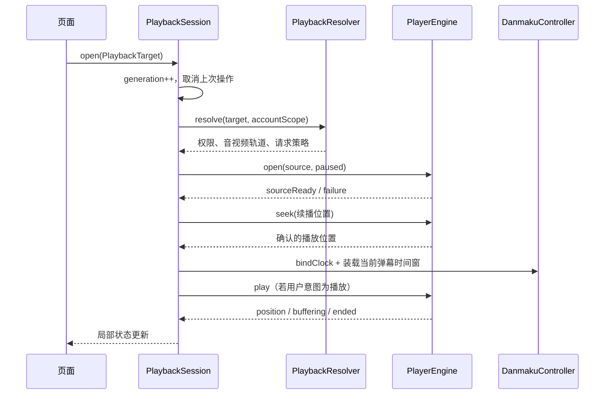
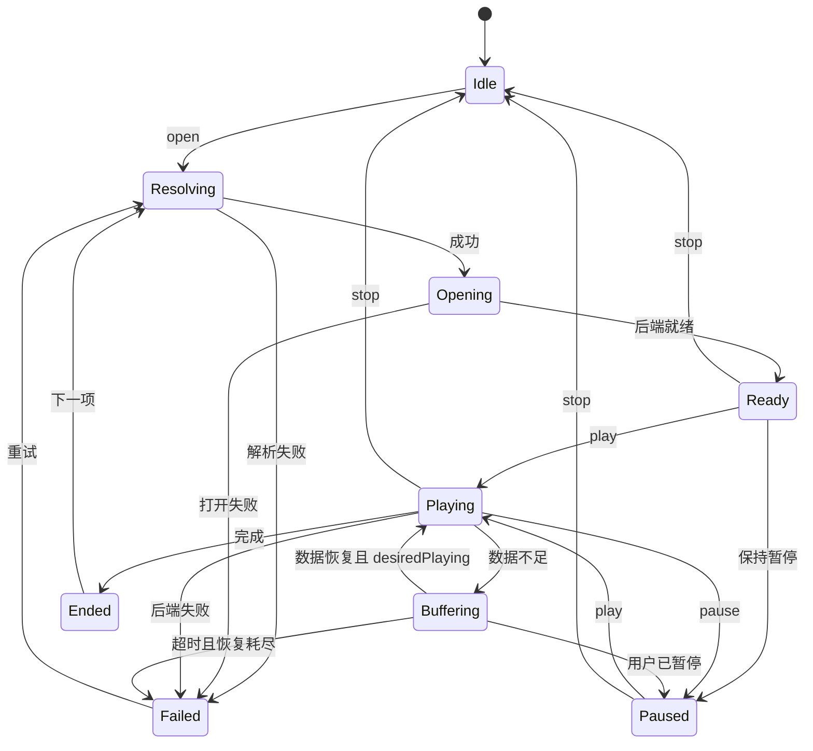

# 播放、直播与弹幕设计

2026-10-31 视频／影视发送样式改为可一次确认的位置与颜色面板，支持 17 个普通 RGB 预设及十六进制／RGB 自定义颜色，按窗口宽度和键盘空间适配。交互、参考来源及验证边界见[发送色板与样式面板](validation/danmaku-send-style-picker.md)。

2026-10-31 弹幕显示增加当前视频首帧门槛：媒体准备完成后，还需视频输出首帧信号、有效纹理与视频显示尺寸齐备，并经过一帧 Flutter 绘制，才挂载弹幕层。普通／全屏、视频／影视／直播／离线播放共用；换源重置并隔离旧通知，暂停和正常缓冲保留已有弹幕。实现与验证见[视频首帧与弹幕同步](validation/danmaku-first-frame.md)。

2026-10-30 增加共享“听视频”模式：独立 DASH 音轨单独打开，普通／全屏使用常驻音频控件，保留播放意图和导航检查点。能力范围、PiliPlus 参考与逐平台验证见[听视频](validation/listen-video.md)。

2026-10-29 开始切换至固定提交的 Predidit canvas_danmaku / media-kit。弹幕继续由本项目控制器持有确认媒体／单调到达时钟、布局和预算，绘制使用上游批量 Canvas 管线；播放器改用 Native Assets 和 Windows D3D11。旧 ANGLE／库插件描述属于历史实现，当前依赖、采用边界和验证见[切换方案](predidit-media-migration.md)。

2026-10-28 手机普通页面保持竖屏窄屏布局；横向视频播放时由物理旋转进入／退出全屏，竖屏点全屏按钮仍可请求横屏。宽屏播放页旋转只调整整体布局，保留当前全屏选择；折叠／展开和分屏边界不冒充旋转手势。保留媒体源、进度、信息标签和滚动位置，Android 16 通过原生窗口接口隐藏系统栏。当前尺寸与所有权规则见[主窗口、播放器旋转与折叠边界](validation/adaptive-window-rotation.md)，最初接入与构建记录见[手机旋转全屏](validation/responsive-player.md#手机旋转全屏2026-10-28)。

2026-10-26 播放画面加入触摸纵向滑动，并按用户后续要求扩展到非全屏：普通／全屏均可左侧调亮度、右侧调播放器音量，默认开启，可在播放设置关闭。Android 使用可恢复的窗口亮度覆盖，其他平台只调暗播放画面；共用音量会话和手势取消边界，见[播放器滑动亮度与音量](validation/fullscreen-swipe-controls.md)。

2026-10-25 播放器移除顶部标题及空降片段状态；Android 单／双标签在播放控件中显示返回／主页，其他平台单／双标签放在顶部导航行，多标签统一隐藏这两个按钮。主页分别恢复播放前页面或聚焦浏览窗口；UGC 右上显示服务端正在观看人数。来源、普通／全屏及刷新／取消边界见 [顶部导航与人数](validation/player-top-navigation.md)。

日期：2026-10-05。首版已使用 `media_kit`，Windows 分轨与请求策略已验证，三端结论仍以完整 M0 为准。本文中的参数为初始预算，不是已测结果；当前证据见 [实测记录](validation/m0-results.md)。

2026-10-16 按用户要求参考 PiliPlus，将 Android Surface load/unload 与相关核心扩展移植到用户 media-kit fork，并固定 Git 依赖；Android 自动解码优先 MediaCodec，弹幕减少无新候选时的重复轨道/缓存工作。来源、采用范围及验证见 [移植记录](validation/piliplus-media-kit-port.md)。

2026-10-11 已接入高能进度条：Windows/macOS 默认开启、移动默认关闭；等待章节确认，无章节才加载，存在章节不请求、不显示。复用唯一会话及已有位置订阅，缓存曲线几何，仅改变已播放裁剪；可选读取不阻塞媒体打开，见 [设计](high-energy-progress-design.md) 与 [实现验证](validation/high-energy-progress.md)。

影视弹幕、直播实时连接/画面弹幕及 SC 状态合并的当前实现和容量限制见 [影视与直播弹幕修复](validation/pgc-live-danmaku.md)；直播使用独立到达时间时钟，继续复用唯一原生播放会话。

2026-10-24 直播弹幕的状态所有者移到共享播放面板外，普通／全屏画面继续共用控制器、到达时钟和实时消息订阅；切换呈现不再清空画面弹幕，页面隐藏／换房等清理边界保留，见 [直播全屏切换](validation/danmaku-fullscreen.md#直播全屏切换2026-10-24)。

2026-10-06 点播已接入云端进度上报；开启记住进度时本地记录优先，仅在本地缺失时读取当前分 P 的云端进度。Web 会话、队列/账号/源隔离及验证边界见 [云端播放进度](validation/cloud-playback-progress.md)。

2026-10-06 点播倍速增加应用运行期间的内存记录：播放页菜单/快捷键修改后，新视频、分 P 与影视剧集继承最近成功选择的倍速；重启应用使用设置默认值。已有源恢复保留自己的倍速，长按临时加速与直播不写入记录，见 [应用会话内继承倍速](validation/session-playback-rate.md)。

2026-10-11 音量沿用应用运行期间的内存继承方式，覆盖普通视频、分 P、影视、直播和离线播放。拖动音量或快捷键调节成功后，后续新源继承最近选择，包括静音；已有源恢复／换清晰度／重试保留自己的音量。关闭全部播放页不清除记录，重启应用回到默认音量，见 [音量继承与验证](validation/session-playback-rate.md#音量继承2026-10-11)。

2026-10-27 增加默认关闭的“全局音量记忆”：开启后，最近成功选择的音量独立持久化，应用重启和后续新源继续使用；默认音量保留但暂不生效。关闭后沿用本次运行内的音量继承，下一次启动使用默认音量。设置兼容、写入合并与验证边界见[全局音量记忆](validation/session-playback-rate.md#全局音量记忆2026-10-27)。

2026-10-07 点播普通／全屏画面支持触摸长按，复用设置中的长按延迟和临时倍速；松开、手势取消或页面／播放源／应用状态改变后恢复原速度。单击、双击及播放意图保留，触摸不受键盘快捷键总开关影响，见 [触摸长按临时倍速](validation/touch-hold-playback-rate.md)。

2026-10-31 增加触摸长按后的上滑固定：提示第二行显示“上滑固定倍速”，上滑后松手仍保持该倍速；固定时再次长按临时使用 1.0x，松手恢复固定倍速，提示“上滑解除固定”，上滑后解除并保持 1.0x。固定／解除作为手动调速沿用运行内倍速记忆；固定标记只属于当前播放源，普通／全屏共用，详见[固定倍速记录](validation/touch-hold-playback-rate.md#上滑固定倍速2026-10-31)。

播放器提供“点击／动态”控件交互设置，默认点击模式。2026-10-30 起，点击模式新打开播放页时控件默认隐藏，准备媒体与开始播放后继续隐藏，单击画面唤出；普通与全屏切换保留当前显隐状态。动态模式由鼠标活动显示控件，静止 2.5 秒或移出画面隐藏；悬停在控件上时保持显示，移开控件后重新计时。弹幕输入框持有编辑焦点时，两种模式都暂停自动隐藏；动态模式移出画面也保留输入，避免输入法候选界面触发失焦，结束编辑后重新计时。动态模式点播画面单击播放／暂停，直播画面单击不改变播放或控件状态。普通与全屏共用状态，设置迁移与验证见 [播放控件与小窗布局](validation/responsive-player.md#动态模式悬停保护与隐藏计时2026-10-09)。

2026-10-27 起，画面双击按实际指针类型区分：触屏双击播放／暂停，鼠标双击切换全屏。此行为在各平台的普通／全屏、点击／动态模式下共用，覆盖视频、影视、直播与离线播放；触屏双击不附带单击动作或改变控件显隐，不新增设置。详见[触屏双击记录](validation/responsive-player.md#触屏双击播放暂停2026-10-27)。

## 1. 四个独立职责

2026-10-11 播放器设置加入标准／高动态／关闭三种音量均衡模式，普通视频与影视共用响度元数据和独立原生增益；默认关闭，无合法元数据时保持原声。协议、切源隔离及平台验证见 [播放器音量均衡](validation/audio-normalization.md)。

2026-10-06 增加视频 CDN 偏好，自动／运营商模式只排序服务端地址。2026-10-28 按用户要求参考 PiliPlus 增加 19 个具体节点与点击展开测速：具体节点允许替换兼容 UPOS `/upgcxcode/` 地址的 host，保留 scheme/path/query 与原始备用地址；默认和有效旧设置继续保留。视频、影视、悬停与下载共用地址规则，直播线路独立。测速串行、有字节／时间上限，关闭或账号变化取消，不创建播放器；边界与实测见 [CDN 设置与测速](validation/video-cdn.md)。初版悬停的 8 秒／一次备用策略已由下段后续修订覆盖。

同日官网加载对照后，悬停改为独立 `DashVideoSource` 无音轨预览，自动模式优先服务端常规 CDN，每地址外层/原生统一 3 秒、最多三个地址；有效 cid 直传。普通点播/影视继续验证音视频分轨，预览不作为完整点播验收；现行预览策略与原因见 [悬停加载验证](validation/video-preview-loading.md)，覆盖上段早期策略。

2026-10-07 所有播放器打开默认采用最多 5 分钟媒体时间的向前预读窗口，悬停预览继续显式采用 5 秒（由最初的 15 秒按用户要求缩短）。`OpenOptions.maxBufferAhead` 必须大于 0 且不超过 5 分钟；适配器在打开媒体之前设置 `cache-secs` 和 `demuxer-readahead-secs`，关闭临时磁盘缓存，保留 SDK 的内存字节限额。窗口随当前位置推进，不截断视频或限制总播放时长；原生分包、解码和网络 I/O 边界有少量超出，内存配额也可能让预读早于 5 分钟停止。普通播放实现与 Windows 证据见 [播放器预读窗口](validation/player-buffer-ahead.md)，预览另见 [悬停加载验证](validation/video-preview-loading.md#5-秒向前预读窗口)。

| 组件 | 所属位置 | 职责 |
| --- | --- | --- |
| PlaybackResolver | 主应用 playback/application，依赖内容 Repository | bvid/cid/episode/roomId → 权限、可选轨道、URL 与请求上下文 |
| PlaybackSession | 主应用 playback/application | 会话、命令串行化、错误恢复、续播、播放队列、进度上报 |
| PlayerEngine | `packages/bili_player` | 通用媒体源打开、解码、音视频同步、seek、事件和 native 资源 |
| DanmakuController | `packages/bili_danmaku`，由会话注入数据与时钟 | 事件调度、轨道、过滤、布局、绘制；无 API 依赖 |

视频解码在原生后端内进行，不把每帧图像通过 Dart/Rust 来回传递。Flutter 在视频 surface 之上绘制弹幕、字幕和控制层；高频重绘局限在对应层。

2026-10-11 共用播放器按字段派生视图订阅：位置与缓冲进度只更新时间、字幕及进度等局部，值相等的快照不重复发布；这不节流确认位置或另建播放状态。影视与直播页面在资料不变时复用播放器子树，主题／设置仍通过 inherited 依赖传播。结构对比与回归见[性能热点第一批结果](validation/performance-hotspots-results-2026-10-11.md)。

同日 P2 优化：保存旧进度后，stop、媒体解析和适用的本地进度读取并行；新媒体 open 仍等待 stop 屏障，保留源 generation、账号代次和用户意图。会话仅保留最多 32 条无 URL／凭据的阶段诊断，不自动上传。字幕用保留原始重叠优先级的时间区间索引，顺播游标／跳转二分，只在 cue 改变时更新字幕。弹幕新增图像缓存回退计数，仍保持每控制器 32 MiB 和原绘制策略。直播保持 20 秒对账，后台相同结果不发布状态；聊天纯内容缓存最多 500 项，稳定条目与相对视口锚点保留滚动位置。实现、测量及平台边界见[P2 优化结果](validation/performance-p2-results-2026-10-11.md)。

2026-10-07 Windows 悬停崩溃转储确认 mpv 核心销毁时渲染上下文仍存在。Windows 构建现在对锁定的 `media_kit_video 2.0.1` 应用可校验补丁：方法通道的 Dispose 回复必须晚于纹理注销、渲染队列排空和渲染上下文释放，随后才允许依赖销毁 mpv 核心。主应用接口不变，补丁来源、顺序约束与未实机验收范围见 [Windows 悬停预览销毁崩溃](validation/windows-preview-dispose.md)。

2026-10-08 Windows 预览和主视频继续共用 GPU 渲染队列；尺寸检查改为消费原生适配器的显示尺寸事件，移除渲染线程对 mpv 核心的同步查询，避免预览启动时约 200 毫秒的等待阻塞主视频。原因、Profile 对照及剩余 GPU 创建开销见 [悬停预览与主视频出帧争用](validation/video-preview-contention.md)。

2026-10-11 Windows 增加可选 `VideoViewportSource`，由共享 surface 按可见区域和 DPR 发送中间纹理上限；保持源分辨率和硬解，放大立即恢复、缩小延迟 300ms，surface 所有权与原生 revision 隔离旧尺寸请求。原生更新通知合并但保留渲染期间的新唤醒和队列公平性。两轮 720p/1080p Profile 已确认纹理面积下降；GPU 百分比仍有波动，未证明固定降幅或转换流畅度提升，详见 [Windows 输出性能](validation/windows-video-render-performance-2026-10-11.md)。

`media_kit` 文档列出了三端、外部音轨、字幕和 HTTP headers 等能力，适合作为首选；这些能力组合后的行为仍需项目验证。[media_kit](https://pub.dev/packages/media_kit)

2026-10-13 Windows x64 使用固定、已修复 ANGLE 扩展检查的 LGPL libmpv 构建，本机 H.264/HEVC/AV1 自动解码实值为 `d3d11va`。输出借用 ANGLE D3D11 device，使绘制和必要复制在同一即时上下文有序提交，以 `glFlush` 代替每帧 CPU 等待；明确相同消费者设备才直接共享，否则保留保护性复制。空点播弹幕不连续刷新，未来事件在有界插值内单次唤醒，播放时钟和暂停/seek 语义保留。前后 GPU 数据、原生回归、Release 构建与未测边界见 [Windows GPU 优化结果](validation/windows-gpu-optimization-2026-10-13.md)。

同日增加 `BILISAIL_VIDEO_FRAME_QUEUE` 构建实验，后续按用户要求改为 Android 默认开启、macOS 和 Windows 默认关闭，显式构建参数可覆盖默认值：DASH 播放可额外启用 8 帧／100 毫秒媒体时间／64 MiB 的解码队列，保留当前解码选择与 seek 策略。硬解兼容性和跳转后掉帧改善须另行实测；容量与启用方法见 [供帧缓冲实验](validation/video-frame-queue-experiment-2026-10-13.md)。

2026-10-14 按用户要求撤回弹幕 17ms 帧驱动，点播／直播重新使用随屏幕刷新率运行的单一 Ticker，并恢复原控制器和空闲唤醒逻辑。该撤回不改变视频解码供帧队列；历史候选测量见 [弹幕高刷合成实验（已撤回）](validation/danmaku-frame-cadence-2026-10-13.md)。

## 2. 通用播放契约

以下为完整目标契约示意；实际公共接口见 `packages/bili_player/lib/bili_player.dart`，现有 DASH/progressive 和 manifest 源；Windows 已验证点播分轨、直播 HLS/FLV。字幕由应用解析并叠加，尚未开放 native 字幕选择和离线源。本轮三类页面及未测项见 [影视与直播内置播放](validation/content-playback.md)：

```dart
abstract interface class PlayerEngine {
  Stream<PlaybackSnapshot> get snapshots;
  Stream<PlayerFailure> get failures;
  PlayerCapabilities get capabilities;
  Future<void> open(ResolvedMediaSource source, OpenOptions options);
  Future<void> play();
  Future<void> pause();
  Future<void> seek(Duration target);
  Future<void> setRate(double rate);
  Future<void> setVolume(double volume);
  Future<void> selectAudioTrack(String trackId);
  Future<void> selectSubtitle(String? trackId);
  Future<void> stop();
  Future<void> dispose();
}
```

- `ResolvedMediaSource` 是 `ProgressiveSource / DashPairSource / ManifestSource / LiveSource / LocalSource` 联合类型，不能用一个裸 URL 表示全部播放形态。
- `DashPairSource` 包含独立视频/音频轨道、codec、码率、分辨率、duration、备用 URL、过期信息及各自的请求策略；无音轨必须区分合法无声视频和解析失败。
- `MediaRequestPolicy` 含允许的目标来源、UA/Referer 等实际所需头、重定向规则。凭据只在会话内存中短期存在；不作为可打印的模型字段暴露给 UI。
- `PlaybackSnapshot` 含 phase、position、duration、buffered、seekable、rate、轨道和播放意图；禁止 UI 直接操作 `media_kit.Player`。
- `PlayerCapabilities` 表示实际可用的外部音轨、字幕、codec/容器、截图等；系统 PiP/媒体键属于 PlatformServices，不能混为后端能力。
- `VideoSurface` 是 bili_player 的 Flutter UI 出口；`bili_player_control.dart` 提供不依赖 Flutter 的控制、诊断和输出生命周期契约，`VideoOutputSource` 提供稳定的输出对象。`VideoCompositionAdapter` 在应用根统一注入，负责画面构建与前景合成；当前仍使用 media-kit Video 与原 Stack，测试可分别替换 engine、output 和 composition。实现与后续平台边界见[输出与合成拆分](player-output-composition-design.md)。

从用户偏好、服务端授权的 representation、后端支持和当前设备能力的交集选轨。优先使用经过验证的 H.264/AAC 组合；HEVC/AV1、HDR、高帧率逐项测试，不仅凭 codec 名宣称硬解成功。

当前设置已提供 H.264/HEVC/AV1 点播编码偏好，以及三类播放共用的自动/软件解码方式。默认 H.264 和 SDK 自动模式；同清晰度优先匹配编码，缺失时使用其他已识别编码。源 generation 捕获偏好，下次打开/重新加载时应用；软件解码保持 GPU 渲染开启。具体选择顺序、SDK 差异和 Windows/其他平台验证边界见 [视频编解码设置](validation/video-codec-settings.md)。

## 3. DASH 分轨处理

Bilibili playurl 的 DASH 响应通常提供 representation 信息而非可以直接播放的完整 MPD。**播放器能打开 MP4 URL，不等于已经实现带独立音轨的 Bilibili 播放。**

首选路径：`DashPairSource → MediaKitEngine`，在暂停状态装载视频与外部音轨，确认轨道与目标进度准备好后统一播放。必须验证外部音轨是否获得需要的 headers、seek 同步和换轨行为，不能用两个互不关联的 Player 分别播放音视频。

2026-10-10 点播打开改为提前配置 mpv `audio-files`，由原生文件加载 worker 装载外部音轨；确认当前选中的外部文件后，播放时继续验证真实音频解码。避免串行 `audio-add` 网络等待占住命令锁，关闭、换源及 deadline 可中断准备。普通点播有不同备用地址时，首地址最多 6 秒（2026-10-11 从 8 秒调整），两次打开共享 35 秒预算；匹配当前文件的 mpv 错误终止事件立即结束就绪等待，普通错误日志继续等待。自动模式首地址仍保留服务端顺序，失败后的备用优先本次响应中的常规 CDN。直播和只有一个地址的源保持原预算。证据、竞态与跨平台边界见 [点播打开优化](validation/playback-startup.md)。

2026-10-24 将 DASH 首次播放时的音频解码失败接入同一备用恢复：打开和音频准备共用最多两次打开额度及 35 秒累计预算，有备用地址的首轮共用 6 秒。暂停打开不主动播放探测，首次播放沿用剩余额度，暂停等待不计时；恢复保留进度、倍速、音量与最新播放许可。此项不增加播放途中音频实际输出的持续监测，边界见[音频解码失败恢复](validation/playback-startup.md#2026-10-24-音频解码失败复用有界备用恢复)。

若首选不满足三端需求，再在适配层评估完整 MPD：从实际返回的 codec、timescale、init/index range、duration 等构造，不凭空填写；优先会话临时文件。只有后端确实需要时才加入本地 loopback 服务，绑定回环地址、随机端口和会话 token，正确处理 Range、Content-Type、清理与访问边界。首版不默认引入本地代理。

如果两条路径都失败，使用相同契约验证 `fvp`；它基于 libmdk，提供额外后端 API，但仍须验证分轨请求头和许可/打包依赖。[fvp 文档](https://pub.dev/packages/fvp)

2026-10-11 进一步比较硬解与画面交付路径，仍保留现有生产后端。后续隔离对照优先考虑三端 fvp/libmdk，以及 Android Media3；硬解支持、解码到渲染器零复制和 Flutter 最终合成属于不同边界。候选的单会话分轨、逐轨请求策略、音画时钟、许可与生命周期门槛见 [硬解后端调研](validation/playback-backend-research-2026-10-11.md)，文档能力不作为本项目实测结果。

### 点播打开流程



`open` 对含视频源须确认视频已解码及本源原生输出信号，不能只凭 HTTP、轨道列表或外部音轨选中就返回成功；暂停打开同样检查，失败仍在打开预算内交给备用线路恢复。纯音频源不等待视频输出。原生输出信号与屏幕实际呈现像素仍是不同边界，`sourceReady`、seek 完成和首帧分别记录指标。实现与受控复现见[点播打开优化](validation/playback-startup.md#2026-10-21-阻止仅音频的打开假成功)。

### 清晰度、换源与恢复

1. 保存确认的 position、pause/play 意图、rate、音量和字幕选择，提升 source generation。
2. 解析当前允许的轨道；以用户偏好筛选可用结果，不能申请未授予的权益。
3. 暂停并重新打开成对轨道，定位到有效位置，再恢复用户意图；MVP 允许短暂缓冲，不承诺无缝换清晰度。
4. 刷新弹幕定位点，丢弃旧后端事件。失败时若旧源仍有效，可尝试恢复一次并清楚提示。

CDN 故障先尝试响应中同一轨道的备用 URL；疑似过期则刷新 playurl，再尝试一次。对每次打开设统一恢复预算，默认最多 3 次后端重开，包含换 CDN、刷新 URL 和 codec 降级，避免各层重试相乘。

2026-10-30 统一点播／直播加载与播放途中失败的自动恢复：视频／外部音频任一轨提前耗尽，先暂停同一 native player；普通缓存不足交给明确启用的 `cache-pause` 同步等待，连续 8 秒无进展则重载。活动播放以 250ms 间隔监测视频缓冲和适用的外部音频时钟，暂停、seek、准备与结束阶段不轮询。CDN 备用与最多两次重新解析共享最多 **3 次 native open** 和 **35 秒 native 准备预算**，首次重试立即排队，再次退避 1 秒；持续正常推进 30 秒后重置故障恢复额度。暂停、播放许可撤销、换源、账号变化和关闭隔离旧恢复，本地离线文件不自动网络重试。实施依据与原生验证见[双轨同步与重试](validation/audio-video-recovery-2026-10-30.md)。

缓冲、准备和自动重试全程（包括退避与首次音频就绪检查）由共享画面居中显示转圈和“正在准备音视频…”，窄窗、普通和全屏一致，不依赖控件展开。恢复完成、取消或重试耗尽后清除恢复提示；手动暂停仍保持暂停。

软解导致持续掉帧/高负载时，允许建议切到较低分辨率或已验证 codec。错误恢复不能无提示改变用户账号、内容、付费权限或全局清晰度设置。

## 4. 播放状态与所有权

采用一个播放 phase 加正交字段 `desiredPlaying / isSeeking / screenMode`，避免把全屏、暂停、缓冲拼成大量组合状态。



公共约束补充：所有活动状态都可 `stop → Idle` 或 `dispose → Disposed`；所有未完成步骤可失败或取消。新 open 从任意非 Disposed 状态进入 Resolving，旧任务作废。状态图展示主路径，不是允许事件的完整代码表；实现时以表驱动测试补齐。

- 命令按会话串行处理，拖动 seek 合并到最后目标，不积压每个拖动事件。
- `seek` 后等待后端确认再重建弹幕时间基线；不能用请求位置冒充已播放位置。
- 切全屏/窗口/布局只改变 surface 的布局和系统状态，不创建第二个音视频播放实例。
- 移动全屏在显示屏最短边小于 600 逻辑像素时，按当前源的已解码显示尺寸选择方向，包含像素宽高比与旋转元数据修正：横向画面横屏，纵向／正方形画面竖屏；尺寸晚到或全屏换源时更新方向，退出／隐藏／关闭后释放本次安装的方向限制。平板等大屏保留系统方向策略，全屏只切换系统栏和播放器布局；判断使用当前 Flutter view 的完整 display 尺寸，避免兼容居中窗口或分屏导致误判。尺寸与方向命令均隔离旧源和旧全屏 owner，具体平台边界见 [移动全屏方向验证](validation/responsive-player.md)。
- 手机前台可见的播放 owner 在横向画面有播放意图、窗口由竖转横时自动进入同一全屏路由；暂停、未知／纵向尺寸、后台、隐藏页及覆盖弹窗不抢占呈现。全屏中 Android/iOS 通过物理方向通知识别锁定界面后的回转，须先确认横拿再在竖拿时退出。系统栏、方向限制和通知订阅随 owner 取消／退出释放；手动退出后保持当前布局，下一次竖转横才重新自动进入。
- 页面订阅销毁与会话销毁分开；播放页关闭时默认停止，应用内小窗启用时显式转交给 PlaybackManager。
- 每个播放标签拥有独立的 `PlaybackSession` 和 engine，同一标签换 P、选集、清晰度或线路仍替换该会话内的源。“允许多个标签页同时播放”默认关闭，仅在多标签模式生效；用户开启后，打开新播放页不停止旧视频，隐藏只移除 surface、绘制与输入。单／双标签或关闭开关时，由 `PlaybackManager` 先暂停旧会话，再放行新会话，许可同样约束迟到解析和排队播放命令。设置立即生效，关闭并发时保留当前／最近选择的播放标签。导航暂停保留原源、进度和用户意图；返回或恢复允许并发时继续，手动暂停保持暂停。切到普通页面保留最近播放会话；关闭标签只释放自己的会话，账号变化与退出清理全部会话。移动系统后台暂停按各媒体 owner 执行，不能把应用内隐藏等同于系统后台音频支持。验证见 [多标签并发播放](validation/multi-tab-playback.md)。
- 暂停、缓冲、后台策略变化都同步通知弹幕时钟；后台恢复不得自动抢占已被其他应用取得的音频焦点。

## 5. 点播弹幕与字幕

播放设置支持默认关闭的连续播放：确认完播后推进下一分 P、合集视频、稍后再看条目或同组影视下一集，到末尾停止。手动下一集与自动推进共用顺序规则和账号/源隔离，普通与全屏控件共享最新动作；自动推进从下一项零点开始。实现及验证边界见 [连续播放与下一集](validation/continuous-playback.md)。

### 数据管线

`DanmakuRepository → HTTP Protobuf → 有界解码任务 → 标准事件 → 过滤/排序 → 预取时间窗 → 轨道调度 → Painter`。

登录后的密集分段可能包含超过 6000 项；当前解码器完整验证响应并将超量分段均匀抽样至最多 6000 条普通弹幕，不将条数超预算直接视为协议失败。字节和单项限制、取消与 isolate 预算继续生效；首集对照及选集子标签交互见 [密集番剧弹幕与选集子标签](validation/pgc-dense-danmaku.md)。

应用层每个分段到达时排序一次，邻近最多三个分段按所需时间窗二分切片／有序归并；渲染器仍收到裁剪 pending 容量之前的完整有效窗口，保留活动弹幕身份。无关设置与页面局部操作不重复整理窗口。隐藏播放 owner 时取消点播弹幕读取、冻结呈现时钟并释放 raster，媒体播放与进度记录继续遵循原策略；再次可见时按确认位置重建当前窗口，不能从隐藏前的动画年龄继续。全屏仍是同一可见播放 owner。

`DanmakuEvent` 包含 string ID、毫秒时间、文本、模式、颜色、字号、必要的屏蔽标识。大批解码/筛选在 isolate；TextPainter 和绘制留在 Flutter UI isolate。一次传一批数据，不为每条弹幕跨 isolate/FFI 调用。

分段长度、分段总数按元信息和已验证协议解释，配置中可使用经验证的 6 分钟策略，但不能把 `total` 当作秒数或假定所有内容相同。只获取当前段和有限相邻段，初始窗口为当前段、后 1 段与前 1 段；缓存容量另有总配额。快速 seek 取消远处请求并提高 generation，按 ID 去重。

### 时钟

点播唯一业务时间源是 PlayerEngine 的确认位置，用于加载分段和决定弹幕何时出现。Ticker 的单调时间在两个位置样本间插值媒体位置：

```text
estimatedPosition = anchorPosition + (monotonicNow - anchorTime) × playbackRate
```

弹幕滚动、固定项停留与轨道占用使用独立的动画时间，累积可播放阶段的单调时间差，不乘播放倍速。播放倍速只影响媒体位置和触发节奏；滚动速度仍由独立弹幕速度设置控制。收到新 position 或调整倍速时先结算旧动画时间，再更新媒体 anchor，保留活动弹幕的滚动进度。

两个时钟都只在确认 Playing 且未 buffering/seeking 时前推；位置样本超过 700ms 未更新时冻结，避免后端已停而弹幕继续跑。暂停/缓冲冻结，seek 清空活动项并从目标时间附近二分检索重建；历史事件的媒体年龄按当前倍速换算为动画年龄，回看范围同时覆盖仍可见的项。回退 seek 允许弹幕再次出现；已调度 ID 只保留在有界当前时间窗，正常刷新不会重播已丢弃或过期的项。实现和测试边界见 [弹幕速度与播放倍速](validation/danmaku-playback-rate.md)。

### 渲染与轨道

现有播放器与全局设置已共用弹幕配置入口，支持独立字体、加粗、阴影/描边/无效果、时间偏移、重复合并、同屏密度、权重/颜色/本地关键词过滤。点播按偏移后的时间调度，直播只允许消息延后；权重过滤仅适用于点播。具体默认值、范围、持久化与未测项见 [弹幕配置验证](validation/danmaku-style-settings.md)。

UGC／PGC 发送栏的模式与颜色由同一播放会话保留，普通／全屏切换后继续使用。成功写入按服务端 ID 加入最多 120 条的会话内回显缓存，沿用原调度与绘制链路；换源、停止、账号／会话变化隔离旧结果，不回显失败／未知结果、不自动重试。回显与远端窗口按 ID 去重，服务端审核与公开可见性仍以远端为准，详见 [发送样式与回显](validation/danmaku-display-area.md#发送样式与成功回显)。

- 基础实现使用 `CustomPainter`、`TextPainter`、`RepaintBoundary`，单一 Ticker；不为每条弹幕创建动画 Widget。
- 支持右到左滚动、顶部固定、底部固定；轨道高度受字号/行高影响，字幕安全区和控制区预留。
- 显示区域先扣除顶部距离与底部避让，再应用 25%–100% 比例；轨道随实际文字行高与区域高度分配，不再固定截断为 24 行。同屏数量仍受 120 条安全上限约束，区域是允许使用的最大范围，不保证弹幕铺满。默认值、容量与回归见 [弹幕显示区域](validation/danmaku-display-area.md)。
- 弹幕行距表示文字布局之间的空白，范围 0–100 逻辑像素，默认 5，0 时紧挨着；轨道高度为最大文字布局高度加设置行距。两处设置入口与点播／直播接入见 [弹幕行距](validation/danmaku-line-spacing.md)。
- 滚动轨道考虑前项的尾部、后项速度及追尾时间，不能只检查初始间距；固定弹幕按显示区间占位。
- 点播与直播的全屏、窗口尺寸和控件避让变化保留活动弹幕的时间进度，只移除超出可用轨道的项；不能清空后重放已丢弃的历史弹幕。零尺寸过渡不消耗调度项；点播保留调度游标，实际 seek 仍按确认位置重建；直播继续按原单调时间过期。验证见 [全屏弹幕保留](validation/danmaku-fullscreen.md) 和 [移动端键盘布局](validation/mobile-danmaku-keyboard-performance.md)。
- 初始上限 120 条同时可见、500 条待调度；不足时优先保持播放流畅，按密度规则丢弃/抽样，不无限排队。
- 字形/段落布局使用含文本、字体、字号、缩放、描边的有界 LRU；用户改字体时失效相应布局，单行弹幕的文字布局不依赖窗口宽度，尺寸变化沿用缓存。
- 2026-10-10 密集弹幕优化：点播时间窗替换只整理事件，不提前布局整窗文字；点播和直播每帧最多准备 32 个到期候选，未处理项继续受原时间、过期和队列容量约束。500 条待调度窗口的容量裁剪不能回收仍在显示的项；活动项依据裁剪前的输入确认过滤和内容变化，并保留身份与动画年龄。轨道按模式/行索引，仅扫描同轨占用；新文本变大时，只在所有已占用行仍能放入显示区的情况下增大轨道，否则丢弃该新候选。活动期间轨道高度只增不减，避免较大文字到期时整屏跳动。
- 阴影、描边和普通文字仅在实际绘制时按显示 DPR 预渲染到 `ui.Image`，后续帧移动图像。每控制器最多 256 个文字布局，图像的 RGBA 像素预算为 32 MiB；优先释放非活动图像，预算不足或图像尺寸过大时沿用原文字绘制，避免活动图像互相挤出。DPR/字体/效果变化、LRU 淘汰和控制器销毁释放原生资源；描边段落按绘制需要才创建。源码依据、基准方法和平台边界见 [密集弹幕性能优化](validation/danmaku-performance.md)。
- 降级顺序：减密度 → 简化描边/阴影 → 限制字体尺寸与轨道；是否进一步降帧要实测，不能拖慢视频控件。
- 支持按模式、关键词和用户规则过滤；任意用户正则可能阻塞，MVP 先提供字面关键词/类型过滤，后续正则需限制执行成本。
- 特效、脚本、高级定位弹幕不在 MVP，未知模式可跳过并计数，不执行内容中的代码。

已有 Flutter 弹幕库只有在“暂停/seek/倍速一致性、Canvas 开销、内存上限、三端字体和许可”均通过后才替换 Painter；保持公共事件/时钟契约。

2026-10-10 移动端键盘布局优化：工作区和三类播放页把可复用内容与高度相关的几何布局分开，共享播放器仅在宽度或标签/排版输入变化时重新测量控件。点播/直播绘制层显式依赖 DPR，直播尺寸变化沿用文字及图像缓存。模拟键盘开合的结构对比和实机未测边界见 [移动端弹幕输入与键盘布局](validation/mobile-danmaku-keyboard-performance.md)。

字幕统一为 cue 列表，与确认播放时间同步。优先在独立 Flutter 层绘制基础文本以控制样式和避让；后续需 ASS 等格式时可使用后端字幕能力，但同一轨道不双重渲染。把 Bilibili JSON 字幕转为 cue 或受支持文本格式，不能把 JSON URL 直接当 SRT。

### 5.1 章节时间轴与预览

普通视频已实现章节分段进度与悬停缩略图：章节和字幕元数据合并读取，雪碧图索引首次悬停才加载；预览保留局部状态、播放源/账号隔离和有界图片缓存，不 seek 或创建第二个播放器。标题按片段可用宽度显示，完整入口保留在章节菜单。协议、生命周期、真实样本与平台边界见 [视频章节与悬停缩略图](validation/playback-timeline.md)。

2026-10-26 点播画面接入触屏横向滑动，普通／全屏共用中央缩略图与「目标时间 / 总时长」提示，底部进度条同步预览，松手提交一次跳转。缩略图复用时间轴的按需索引和图片缓存，拖动仅更新局部预览与进度；取消、切源、后台及模态变化丢弃未提交目标。行为、绘制隔离和验证边界见[触屏滑动进度](validation/touch-swipe-seek.md)。

列表视频卡另使用真实视频悬停播放：复用 Web/WBI 点播源接口请求低清晰度，通过独立、静音的临时 PlayerEngine/VideoSurface 播放。预览不属于正式播放标签，不访问进度存储或上报；进程级管理器最多保留一个预览，切换前等待释放，离开/隐藏/后台/账号转换均取消。网页实际请求、容量与原生验证见 [视频卡悬停播放](validation/video-card-hover.md)。

2026-10-26 增加独立的“设置 → 播放 → 视频卡悬停播放”选项，Android 默认关闭、其他平台默认开启，保留用户已保存的有效选择。预览组件只在开启且卡片实际悬停、页面可见时挂载；关闭或未悬停时跳过预览专用生命周期／滚动监听、定时器和播放器组件。关闭后取消已有等待、请求和预览；重新开启后仍按前台、滚动状态及 200 毫秒等待启动。该选项不改变正式视频的自动播放，迁移、资源收益及验收边界见[悬停播放设置](validation/video-card-hover.md#2026-10-26悬停播放设置)。

## 6. 直播媒体与消息

直播使用同一个 PlayerEngine，但独立 `LivePlaybackPolicy`：选择服务端提供且后端可播的 HLS/HTTP-FLV 等组合；协议、容器、codec、线路是不同维度。M0 同时验证 HLS 与 HTTP-FLV，正式默认选通过验证且稳定的线路组合。

2026-10-30 普通／全屏统一直播选择器，可选择实际返回的协议／格式／编码和流内 CDN，并保存组合偏好；自动模式保留 AVC/fMP4 HLS 优先，缺少偏好时回退，不根据平台名称宣称解码支持。点播另识别杜比视界并按音质偏好选择 AAC／FLAC／杜比音轨；行为与逐平台验收见[直播流与点播音质偏好](validation/live-stream-audio-preferences-2026-10-30.md)。

直播不复用点播的续播位置、完播和分 P 逻辑；默认不可 seek，除非服务端明确提供回看窗口。重连后追直播边缘，不 seek 到断线前的时间。缓冲长度作为播放策略配置，先保证稳定，再测延迟。

`LiveChatSession` 的状态：Idle → FetchingConnectionInfo → Connecting → Authenticating → Connected → Backoff / Offline / Closed。

- 每次连接取当前 roomId、token 和候选 host，不能永久硬编码单一 WS 地址。
- 使用完整 packet length/header length/version/operation/sequence 校验。正确处理单 message 内的多个包与解压后的嵌套包；库若暴露帧，则先按其 API 聚合完整 message。
- 实现并验证 raw/zlib；Brotli 必须有解码器和 fixture 后才声明协议版本 3，不能广告不支持的压缩。未知版本形成可诊断失败或已验证的协议降级。
- 初始限制单包 1 MiB、单批解压 8 MiB、嵌套 4 层，超限丢弃并受控重连；这些阈值由正常直播样本验证调整。
- 鉴权成功后按已验证协议发送心跳（初始按 30 秒验证），超时或无响应判定失联；重连指数退避+抖动，上限 30 秒，连续 5 次失败后进入需要用户重试的状态。
- 切房间、退出、后台策略变更都会停止心跳、定时器和重连任务。恢复网络先重新获取连接信息，避免沿用过期 token。
- 解析、聊天列表和屏幕弹幕使用独立有界队列。状态/鉴权消息优先，普通聊天超限丢最旧；初始聊天列表保留 500 条，UI 批量更新。
- 直播弹幕基于收到消息的单调时间调度，视频缓存造成的延迟仅允许用户偏移；服务端未提供可靠映射时不声称逐帧同步。重连不重播积压弹幕。

媒体断线与消息断线独立恢复：聊天室暂时断开不能停视频；视频缓冲也不能无限堆积弹幕。房间已下播进入明确 Offline 状态，不持续刷播放 URL。

## 7. 下载与离线扩展

M4 复用 PlaybackResolver 的轨道选择，下载走独立 `TransferEngine`；不通过录屏或实时转码完成下载。

任务状态：Queued → Resolving → Downloading → Verifying → Completed；中间可 Paused/Failed/Cancelled。下载器属于进程级服务，不绑定下载页生命周期。初始并发 2 个任务、每任务至多 2 个传输，播放出现带宽压力时降低下载并发。

记录内容标识、账号 scope、轨道 representation/codec、已完成 ranges、总大小、ETag/Last-Modified（如有）、文件相对路径。URL 过期重新解析同一资源；必须确认新内容与原部分文件可拼接，否则重下该轨道。

断点续传验证 `206 + Content-Range`、长度和校验信息；收到 200 时不能追加整个文件，416 时核对大小而非直接标记成功。先写临时文件，验证后原子改名并事务提交索引；崩溃恢复能处理“文件完成但数据库未提交”的中间状态。

离线 manifest 带 schema、contentId/cid、相对轨道路径、时长、大小/校验及字幕/弹幕。M4 首版先直接播放本地分轨，合并导出延后到有明确需求时。离线文件不是普通缓存，清缓存不删除它。

Android 初期只承诺前台下载与重启恢复；后台持续下载必须另做系统服务和权限验证。macOS 目录授权、Windows 文件占用、磁盘不足、跨盘移动、取消清理都需要平台测试。

## 8. 后端验收与诊断

2026-10-30 接入系统媒体通知和控制：Android 媒体通知、Apple 正在播放、Windows SMTC、Linux MPRIS 通过共享会话管理器观察同一播放器，系统命令沿用会话和源／账号隔离；多标签只选一个系统目标。随后 Android 增加退后台自动听视频、回前台恢复原模式，前台服务保留到停止／关闭，详见[Android 后台听视频](validation/android-background-playback.md)。其他移动平台沿用后台暂停策略，逐平台构建与设备边界见[系统媒体通知与控制](validation/system-media-controls.md)。

M0 必测：三端带真实请求头的分轨音视频、暂停/seek/倍速、音画同步、前后台、全屏、线路失效、HLS/FLV、密集弹幕以及 30 分钟持续播放。

记录首帧、seek 到恢复画面、buffering 时长、backend error、视频 dropped frames（后端提供时）、Flutter UI/raster 帧耗时、CPU/GPU/内存。Flutter 帧率与视频解码掉帧是两个指标，不能互相代替。

不假设单个基准能证明全部硬解/codec 可用。播放器失败记录阶段和错误分类，对媒体 URL、native 日志和 headers 脱敏。量化预算及验证记录格式见 [实施与验收](implementation-plan.md)。
