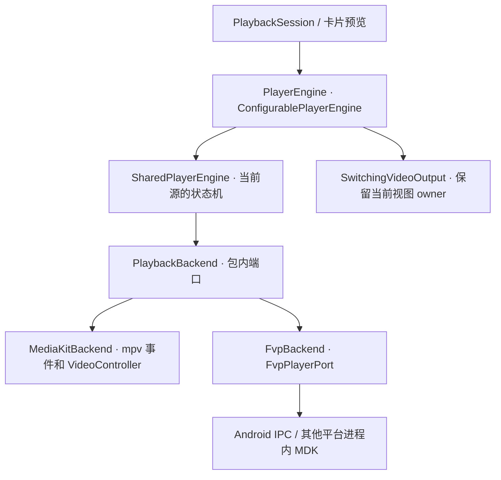

# media_kit 与 fvp 播放后端重构方案

> 历史记录：fvp／MDK 已于 2026-11-12 移除。下文保留当时实现与验证事实，相关源码、资产和专属命令已退役；当前行为见[移除记录](validation/fvp-removal-2026-11-12.md)。

2026-11-12 后续：源与原生实例生命周期已分离，兼容换源可复用；mpv 改用 EDL 和 SDK 事件，移除 weak client 与周期音频时钟查询。下文的单源实例与旧双轨/健康机制属于历史设计，现行边界见[换源复用记录](validation/player-source-reuse-2026-11-12.md)。

2026-11-08 后续：进度／缓存／跳转按[控制流程简化](validation/player-control-simplification-2026-11-08.md)进一步调整。共享状态所有权保留，HTTP DASH 交原生缓存，事件和采样共用确认时间线，seek 采用一个执行操作加一个最新目标；该记录的本次验证边界优先于下文历史原生验收。

**状态：已实施共享状态机，逐平台验收见[实施记录](validation/player-backend-refactor-2026-11-08.md)。** 设计于 2026-11-08，基于 `22ac962f` 及当时工作区的 fvp 连续 seek／片尾修复。下文“现状”保留设计时的基线，“目标”和“验收”规定实现约束，不能当作全部设备已通过的声明。

## 1. 重构从哪里开始

主应用已经通过 `PlayerEngine` 使用播放器。组合根为播放标签和卡片预览注入同一个工厂，`ConfigurablePlayerEngine` 在每次打开源时读取后端选择。真正重叠的是再往下的两份实现。比如同一次拖动，两端各自处理取消旧目标、记录暂停意图、等待新位置、更新快照和决定是否恢复声音。需要 mpv 或 MDK 专门完成的只有其中的原生操作和就绪确认。[组合根](../lib/app/dependencies.dart) · [公开契约](../packages/bili_player/lib/src/player_contract.dart) · [media_kit 实现](../packages/bili_player/lib/src/media_kit_engine.dart) · [fvp 实现](../packages/bili_player/lib/src/fvp_engine.dart)

设计决定是**保留应用侧接口，在 `bili_player` 内实现一份播放状态机**。状态机决定何时可以播放、解除静音、提交 seek、结束或报错。两个适配器负责操作各自的播放器，并提供作出这些决定所需的证据。

| 现有位置 | 已经共用的部分 | 本次要收拢的部分 |
| --- | --- | --- |
| `PlaybackManager`、`PlaybackSession` | 标签互斥、用户意图和播放许可、选流、恢复预算、续播、弹幕及系统媒体编排 | 继续通过现有快照和命令工作。预览沿用独立短会话，共享同一引擎实现 |
| `ConfigurablePlayerEngine` | 下次打开时选择后端、等待旧实例释放、稳定的输出对象、对外代次 | 保留这层选择与转发，补齐工厂尚未返回时收到暂停的边界 |
| `MediaKitEngine`、`FvpEngine` | 已调用同一个起播函数和轨道健康算法 | 源校验、命令优先级、状态发布、首次 play、seek／EOF、健康采样调度、失败与清理流程分别只实现一次 |
| 原生加载、输出与探针 | 已有可复用的等待函数、输出契约和 Android URI 租约 | 插件的调用顺序、回调辨认、进程和资源释放归相应适配器 |

源码入口见[会话](../lib/features/playback/application/playback_session.dart)、[标签管理](../lib/features/playback/application/playback_manager.dart)、[预览](../lib/features/video/application/video_card_preview_playback.dart)、[可切换引擎](../packages/bili_player/lib/src/configurable_player_engine.dart)、[起播门槛](../packages/bili_player/lib/src/playback_startup.dart)和[健康判断](../packages/bili_player/lib/src/native_playback_health.dart)。

## 2. 接口与状态所有权

以下类型已在包内落地。固定后端构造器 `MediaKitEngine(...)`、`FvpEngine(...)` 委托给同一个 `SharedPlayerEngine`，只提供各自的适配器工厂。保留已导出的构造参数、可选端口和原生诊断／基准入口，现有直接构造播放器的测试也走共享状态机。组合根仍能使用 `ConfigurablePlayerEngine(createEngine: ...)` 注入后端或测试替身。主应用与其他包继续使用公开入口。

**包内端口 `PlaybackBackend`** 每个活动源持有一个实例。下表规定操作及其完成条件，足以编写不依赖 SDK 的假后端。

| 操作或信号 | 契约 |
| --- | --- |
| `prepareMuted(plan, operation) → PreparedTracks` | 接收已校验的主轨、可选外部音轨、轨道要求和打开选项。在可能出声之前静音，按起点准备。返回已发现／选中的轨道、时长和显示尺寸。外部音轨必须对应此次请求。共享层核对结果，再决定需要哪些就绪信号 |
| `confirmVideo`、`confirmAudio`、`confirmPresentation` | 分别确认当前源的视频解码和原生输出、实际音频解码、当前显示目标的首帧。异步等待接收同一个操作上下文。某些输出要先挂载再预滚，由适配器在准备流程内安排；共享层能区分“仍在等”和“此源无需该信号” |
| `play`、`pauseAndWait`、`setRate`、`setVolume`、`setGainDb` | 操作针对同一原生管线。暂停返回是否确认原生整组停止推进；故障路径无法确认时，共享层打断并等待释放。共享层分开保存用户音量、增益和临时静音；适配器转换 SDK 的单位、滤镜和属性。用于起播屏障的静音和音量恢复必须可等待，Android fvp 目前的 `void setVolume` 只派发 IPC，迁移时需让 worker 应答后再完成该操作 |
| `seekTo(target, operation) → Duration` | 返回当前时间线已确认的位置。带视频时包含目标视频就绪，纯音频使用音频位置。替换目标时可就地重准备，仍使用同一播放实例和画面输出 |
| `cancelSeek`、`interrupt`、`dispose` | 可以在另一个命令等待原生 I/O 时调用。分别撤销在途 seek、打断整个源、等待资源实际释放。取消旧回调所需的原生屏障须在复用 SDK 回调槽前完成 |
| `events`、`sampleHealth` | 事件表达时钟、缓冲、自然结束、可恢复告警、致命错误或进程退出。统一位置与缓冲终点为媒体时间的 `Duration`。健康采样只取本次可用证据，可区分音频帧数、音频时钟、视频活动与缓存终点 |
| `videoOutput`、`inspectPlaybackInformation` | 输出沿用 `VideoOutput` 的 attach／viewport／detach。只读信息沿用 `PlayerPlaybackInformation`，保留可空指标、实际后端和源代次。面板采样仍由现有控制器按可见性启停 |

**状态归属。** 会话持有账号 epoch、内容身份、用户想播放的意图及工作区给予的许可。可切换包装层持有外部 generation、当前子引擎和释放屏障，只转发当前子引擎的快照、失败和信息。共享引擎持有当前源的命令意图、已确认位置、`PlaybackSnapshot`、seek 序号和采样计时器，是当前源唯一能写播放状态的地方。适配器只持有原生对象、订阅及原生请求与源／seek 序号的对应关系。Android worker 的 IPC 序号继续在消息产生处绑定，不能在收到迟到事件时给它补上“最新序号”。

**观测值的能力边界。** `PreparedTracks` 分别表达媒体列出了哪些轨、选中了哪条外部轨，以及哪些轨已解码。起播、seek 所需证据缺失时，让当前操作在预算内失败并沿用既有错误分类。播放信息面板的可选指标缺失时只留空。适配器可为无原生请求编号的 SDK 建立“取消 → 排空旧回调 → 开始新请求”的屏障；无法归属的事件不能确认新的 seek 或首帧。

**包内落点。** 先在现有 `src/` 下增加 `playback_backend.dart`、`shared_player_engine.dart` 和源校验模块，迁移时把两份原生操作分别收进 `media_kit_backend.dart`、`fvp_backend.dart`。复用现有 `finishSynchronizedStartup`、`NativePlaybackHealth`／`NativeTrackHealth`、等待函数和输出对象。共享模块只依赖契约、时间和观测值，禁止导入两个 SDK 或按后端名称分支。已有 `FvpPlayerPort` 继续隔离进程内与 Android 实现，插件专用的诊断方法留在固定后端入口。[等待与迟到资源释放](../packages/bili_player/lib/src/native_readiness.dart) · [fvp 原生端口](../packages/bili_player/lib/src/fvp_native_player.dart) · [Android IPC 命令](../packages/bili_player/lib/src/android_fvp_player.dart) · [输出转接](../packages/bili_player/lib/src/switching_video_output.dart)

## 3. 源校验与准备计划

先把两份 `_validate` 合并成纯 Dart 校验，返回 `ValidatedSource`。只保存本次打开所需的 `MediaTrack` 和策略，不记录 URI 或 headers。平台可接受的 scheme 由工厂注入；Android 的 `content://` 在实际使用它的进程租借，内部转换的 FD 只在适配器内流转。

| 来源 | 两端都要执行的规则 |
| --- | --- |
| 普通 DASH／PGC、离线分轨 | 需要视频和指定外部音轨。缺音轨在分配原生资源前失败；主文件的内嵌音轨不能冒充指定音轨 |
| 明确无音轨的完整视频 | `DashPairSource(audio: null, isIntentionallySilent: true)` 只要求画面。保留用户音量和完整视频语义，应用据轨道能力控制听视频入口 |
| 悬停预览 | `DashVideoSource` 强制静音，预读 5 秒。沿用兼容输出、每地址 3 秒、最多三个地址和预览释放屏障，预览不写历史 |
| 听视频 | `ProgressiveSource(isAudioOnly: true)` 必须实际有音频且无视频，保留续播位置，跳过视频输出和 Flutter 帧等待 |
| 混合文件／渐进流／manifest | 现状是 media_kit 可按实际轨道接受未标记的纯音频，fvp 对未标记渐进源／manifest 要求视频。拟统一按轨道清单判断，只有实际列出音频且没有视频轨才按纯音频准备；列出视频但解码无画面必须失败。新增混合、仅音频、视频解码失败、无有效轨四组契约用例 |
| 直播 HLS／FLV | 保留 live 标志、无固定时长、1× 和不可 seek；不等待点播目标位置。直播线路、消息及到达时钟仍由应用持有 |

共同约束包括非负起点、有限正倍速、音量 0–100、增益 −60 至 +30 dB、正打开时限，以及大于零且最多两分钟的前向预读。接受 http／https／file 和 Android content。请求头只接受 `User-Agent`、`Referer`、`Origin`、`Accept`，拒绝 CR/LF 和凭据头。双轨按不区分大小写的头名比较，两端目前都要求值相同。`externalAudioHeaders` 表示能将这些头用于外部音频，不能用它推导支持两套不同的头。真实 Range 和重定向仍通过原生 HTTP 夹具验收。[无音轨视频](validation/silent-video-playback-2026-11-08.md) · [预览策略](validation/video-preview-loading.md) · [缓冲窗口](validation/unified-buffer-window-2026-11-07.md)

## 4. 一份状态机如何驱动两个后端

### 打开与首次播放

1. `open` 同步撤销旧操作并分配新代次。打断原生等待，解绑旧输出，确认旧实例释放后才创建新实例。打开中的 seek 只排队保留最后一个目标。若用户在读取设置或创建适配器时暂停，包装层也记录此次打开的暂停意图，新实例不能按旧的 `play: true` 起播。
2. 在同一打开预算内完成源校验、暂停准备、轨道发现、初始位置及所需视频确认。用单调时钟传递剩余预算，覆盖工厂、租约和原生等待。工厂迟到返回的资源也有释放者，直到能确认旧分配已收回才复用相应资源。
3. `finishSynchronizedStartup` 在暂停状态等待当前目标的音频和视频解码及当前输出呈现。确认期间不调用 play，不强制改变用户音量。每次 await 后复核源与播放意图；确认后应用最新用户音量、增益，再启动。需要音频时不能仅凭旧解码参数或轨道存在放行。
4. `open(play: false)` 后的首次 play、正常暂停／继续、seek 后恢复均经过同一屏障。media_kit 核对当前 load／seek 的 PLAYBACK_RESTART，fvp DASH 核对真实音频管线的音频 seek 完成与视频目标帧，视频跟随原生音频时钟。取消、超时、用户暂停及源替换均不得启动旧操作。[现行实现与验证](validation/paused-pair-synchronization-2026-11-08.md)

### 命令、seek 与 EOF

生命周期操作串行等待释放。普通控制只串行**下发**，不能把一个等待视频数据的 Future 挡在下一次 seek 或暂停前面。每个操作捕获源代次、相关命令序号、取消信号和截止时间。原生超时后还要主动打断底层读取。同步快照监听器可能在发布时立刻关闭或换源，此后执行原生副作用前再次核对身份。

| 事件 | 共享状态机的决定 | 适配器必须确认的事实 |
| --- | --- | --- |
| 用户连续拖至 A、B | 立即用 B 撤销 A。视频保留上一帧，音画一起等待。期间保留上次确认位置，忽略 A 的 EOF、失败、时间采样和完成回调。只有 B 能清除 `isSeeking` 并提交新位置 | mpv 等本次 SEEK 与 PLAYBACK_RESTART，替换在途读取走原实例 loadfile／restart 并核对目标位置；MDK 等目标解码回调，重准备时同步定位音频伴随管线并保留纹理 |
| 用户在 B 就绪前暂停、恢复或换源 | 暂停立即撤销旧播放许可，打断待放音命令。B 就绪时复核最新显式意图；只允许当前源的新 play 放音。换源／stop 后 B 不可提交 | 原生暂停确认、当前请求的回调屏障、在途网络读取可取消。Android 状态、位置与回复都校验 seek 序号 |
| EOF 附近拖动、正常结束、重播 | 在途 seek 隔离旧 EOF；自然结束只发布一次 `ended`，清除临时标志，尾随 buffering／playing 事件不能复活播放。重播按会话既有 seek 到零再播放，恢复采样。提前断轨走中断路径 | MDK 在当前 seek 内仅对 busy／unloaded／绑定拒绝（−2／−3／−10）有界重准备一次，IO／Range 错误直接返回。mpv 保留原生事件计数与位置容差 |

原生目标准备沿用 mpv 12 秒、MDK 15 秒上限；内部重准备共用原截止时间。两种直接构造入口当前对负 seek 有“抛参数错误”和“夹到零”的差异，实施先用测试固定这两种既有行为；通过正常应用入口统一归一化，公开入口兼容处理留在薄封装。直播直接由共享层短路。[mpv seek](validation/seek-av-synchronization-2026-11-07.md) · [fvp seek](validation/fvp-seek-synchronization-2026-11-07.md) · [连续目标分发](validation/rapid-seek-latest-target-2026-11-07.md) · [工作区片尾修复](validation/fvp-rapid-seek-eof-2026-11-08.md)

### 稳态、失败与释放

- **快照。** 状态机按“当前代次 → 终态 → 正在打开／seek → 用户意图及缓冲”处理事件。当前 mpv 会发中间 `ready`，fvp 直接结束于 playing／paused。目标是在确认本次打开所需的轨道与输出后统一发一次 `ready`，再按最新意图发布 paused、playing 或 buffering；迟到的 playing／buffering 事件不能覆盖终态。暂停时即使原生正在缓冲，也保持暂停意图。已确认位置驱动字幕、弹幕、续播及上报；相同快照去重，高频变化继续走现有局部订阅。
- **健康。** 复用 250 ms 采样、单轨缺失最多约 2 秒、双轨同步缓冲 30 秒的既有判断和末尾容差。mpv 提供 weak client 异步音频时钟、缓存终点及主位置；MDK 提供实际播放管线的音频帧计数、位置及提前 EOF。MDK 的“已缓冲时长”先换算成时间线终点。将现有 `paired` 参数所启用的 mpv 时钟／缓存比较限定于有对应证据的输入，缺失用空值，暂停、seek、恢复与换源重置基线。采样不能阻塞超时计时；不从媒体位置推断最终合成画面仍在刷新。[双轨停滞](validation/paired-stall-synchronization-2026-11-07.md) · [缓冲保帧](validation/buffering-frame-retention-2026-11-07.md)
- **故障。** 告警、致命失败、取消分别处理。mpv 的 error stream 含可恢复日志，沿用 `NativeErrorMonitor` 的进度宽限；MDK 提供 invalid／processExited 等事件。共享层在中断位置暂停整组，必要时打断或释放，再提交一次失败。当前打开或控制命令的 Future 及 `failures` 用同一代次与失败分类，保证应用只触发一次恢复；过时操作安静结束，可选信息读取超时返回不可用。
- **恢复。** CDN 主备、URL 刷新、兼容画质、账号和断点归 `PlaybackSession`。沿用其 35 秒预算、存在备用时的主地址 6 秒窗口、故障周期内最多三次原生打开及最多两次自动恢复。暂停、导航撤权、关页或账号变化都可撤销恢复。离线失败不刷新网络；`nativeProcessExited` 只允许显式重新打开；`unsupportedVideoColor` 交给已有的在线兼容流分支。适配器不得另起 CDN 重试或自动切换后端。
- **释放。** stop／dispose 立即封住旧事件、取消计时器和等待，解绑视图，撤监听并等待原生线程／进程、纹理及 FD 安全释放。并发 dispose 等待同一个 Future。stop 抛错仍执行 dispose；释放状态未知时保留旧实例的屏障，禁止再分配另一实例。其他会话的资源归各自所有，Android fvp 共享子进程退出时按宿主报告逐个终止受影响的实例。[切换与释放测试](../packages/bili_player/test/configurable_player_engine_test.dart) · [Android 子进程与租约](validation/android-fvp-process-isolation-2026-11-07.md)

## 5. 两端的适配清单

| 机制 | media_kit／mpv | fvp／MDK |
| --- | --- | --- |
| DASH 与起播 | loadfile 前写入并读回 `audio-files`，确认选中本次外部轨；检查解码参数、原生输出和首帧 | 静音音轨探针先释放，再在实际播放器挂外部音轨；实播音频帧和视频输出分别确认。Android 直出等待已绑定 Surface 的消费，兼容纹理等待揭示后的 Flutter 帧 |
| 预读与输出 | `cache-secs`、`demuxer-readahead-secs` 写后核对；直播与点播各自的字节上限、预缓冲、内存缓存保留 | `setBufferRange` 接收同一媒体时间窗口。按 MDK 的缓冲单位和触发条件验证；不得把 mpv 的字节配额当作 MDK 已实施能力 |
| 倍速、音量与增益 | 原生倍速、变速音频缓冲、增益属性写入与读回。把 `NativeAudioGain` 已有的增益平滑曲线、目标取代和取消规则提到共享层 | MDK playback rate、百分比换算及音频滤镜。接收同一基础音量和增益序列，验证更新滤镜时不会重开源或中断实际音频；可听连续性列入设备验收 |
| 解码与画面 | 现有软／硬解选择、像素比例与旋转、Android 输出和 Dolby Vision 色彩映射／读回，保留已启用的原生配置及实验探针 | 解码器选择、比例／旋转、Android Surface 预滚、HDR／软件解码选兼容路径。现状可读部分色彩元数据，尚无与 mpv 等价的 Dolby Vision 输出验证；以同一色卡／受控源验收，能确认不支持时映射 `unsupportedVideoColor`，未知能力单列 |
| 视图生命周期 | `MediaKitVideoOutput` 管 controller、尺寸和首帧；按当前 owner 写 viewport | `NativeTextureVideoOutput` 管 texture、遮罩与呈现；保留原始纹理尺寸。两端的普通／全屏／小窗交接仅转移显示目标，缓冲和 seek 保持最后一帧 |
| 信息、安全与专用故障 | allowlist 属性异步采样，日志先分类；原生时钟、帧队列和硬解探针供专项验证 | 进程内或 IPC 读取 MDK 可提供的标量；缺少的 A−V 差、丢帧等显示不可用。子进程死亡立即退役它的纹理；`content://` 的主轨、音轨和独立探针在子进程分别租借 |

应用按实际设备能力呈现解码和输出选项。默认 media_kit，可选 fvp，变更设置下次 open 生效。已移除的 fsplayer 设置值沿用现有回退。重构无需迁移用户偏好或更换依赖。[解码与输出设置](validation/gpu-device-settings-2026-11-07.md) · [播放信息指标](validation/player-information-tab-2026-11-07.md) · [后端清理](validation/playback-backends-2026-11-08.md)

## 6. 实施顺序与退出条件

| 顺序 | 可独立审查和回退的改动 | 进入下一步的条件 |
| --- | --- | --- |
| 1. 固定基线 | 纳入工作区最新 seek／EOF／IPC 修复，以两个真实构造器和应用工厂运行同一组黑盒用例；记录暂停、首帧、seek、终态和释放的事件顺序 | 已区分两端共同约束、SDK 专用证据及准备修齐的现有差异，原生基线可复跑 |
| 2. 提取无副作用的策略 | 先迁移源与参数校验、轨道要求、请求头、缓存窗口和单位规范，两个旧引擎立即调用同一个实现 | 覆盖合法／非法源、听视频、直播、静音预览和旧保存设置，失败发生在原生分配之前 |
| 3. 打通第一条完整路径 | 用可控时钟和假端口实现共享状态机，先接已有 `FvpPlayerPort` 的 fvp；在同一改动中删除 fvp 已被接管的状态写入和计时器 | 进程内和 Android IPC 都通过起播、片尾连续 seek、取消以及释放专项；每个源只有一个状态写入者 |
| 4. 接入 media_kit | 接入已有 load observer、首帧、音轨健康、色彩和输出端口。把旧引擎缩为固定后端入口，保留原生诊断方法 | 在同一契约套件上用两个工厂通过相同的行为断言；延迟视频、提前断轨和取消等待有原生证据 |
| 5. 通过正式入口验收 | 经过设置工厂、真实会话、预览与平台呈现执行下表。清除已经迁移的重复分发、状态转换和临时桥接 | 任何只能在单一后端通过的机制都有明确的原生能力限制、用户行为及对应测试；缺少设备证据的项目保持待验 |

每步单独提交并可按步回退。迁移中不并行打开两套引擎进行“影子播放”。如一个阶段破坏声音、首帧或释放屏障，应退回该适配器迁移，保留前阶段的契约用例用于复现。

## 7. 验收矩阵

下表是**实施后要运行的验收**。对外行为使用同一份参数化断言，每行分别记录 media_kit／fvp、平台、输出模式、通过或缺失证据。两端可使用不同原生探针证明同一结果。

| 场景 | 两端都要观察到的结果 | 测试入口 |
| --- | --- | --- |
| 起播／首次 play | 分别延迟音频和视频，覆盖自动播放及主应用的暂停打开后播放。两轨均就绪前原生播放进度不推进；等待中调音量、暂停、换源都不能被旧操作覆盖 | [共享门槛测试](../packages/bili_player/test/playback_startup_test.dart)、[延迟双轨原生夹具](../integration_test/windows_playback_startup_test.dart)。补非零用户音量的原生写入顺序断言 |
| 输入、网络与离线 | 外部轨正确；异头、凭据、缺轨提前失败；普通无音轨视频与预览可区分。覆盖 Range、重定向、备用地址、HLS／FLV、文件分轨与封装文件、Android content 租约回收 | [fvp 来源／HTTP](../integration_test/fvp_backend_test.dart)、[完整无音轨](../integration_test/silent_video_playback_test.dart)、[听视频](../integration_test/audio_only_playback_test.dart)；补齐同素材的两端调用 |
| 连续 seek、暂停及重播 | 延迟 A 后连续跳到片尾、再回 2 秒；A 的 EOF／异常／采样迟到不能写回，B 等目标帧且保留暂停。正常 EOF 只推进队列一次，重复重播后位置继续更新 | [mpv seek](../integration_test/windows_seek_synchronization_test.dart)、[MDK seek](../integration_test/windows_fvp_seek_synchronization_test.dart)、[连续片尾](../integration_test/fvp_seek_end_test.dart)、[重播](../integration_test/playback_replay_test.dart) |
| 双轨健康与恢复 | 单独截断音频／视频、同时断流、短时补数、缓存充足但时钟冻结；核实原生双轨确实暂停、最后一帧保留，恢复从确认边界开始。失败事件与命令 Future 同时到达也只消费一次预算 | [健康策略](../packages/bili_player/test/native_playback_health_test.dart)、[mpv 受控停滞](../integration_test/windows_video_stall_test.dart)、[MDK 外部音轨](../integration_test/windows_fvp_audio_recovery_test.dart)、[会话预算](../test/features/playback/playback_session_test.dart) |
| 时间、参数与诊断 | 普通两分钟／预览五秒，缓冲终点单位一致；倍速、临时长按与恢复、基础音量和独立增益可验证。信息页在关页／切后端后丢弃迟到样本，隐藏时停止只读采样，日志中无路径、URL 或凭据 | [缓冲](../integration_test/windows_buffer_ahead_test.dart)、[预览窗口](../integration_test/windows_preview_buffer_test.dart)、[增益](../integration_test/windows_audio_normalization_test.dart)、[切换后信息](../packages/bili_player/test/configurable_player_engine_test.dart)；增益和快速调速增加 fvp 对照 |
| 正式入口与业务副作用 | UGC 换 P／PGC 换集、清晰度／音质／语音切换、听视频／后台、系统媒体键、投屏交接、定时停止、播完暂停／循环／显式队列边界，均保留会话意图。弹幕、字幕、进度上报只跟随确认时间线，切账号撤销旧请求 | [会话测试](../test/features/playback/playback_session_test.dart)、[内容回归](../tool/test-windows-content.ps1)。在真实 `ConfigurablePlayerEngine` 工厂上补双后端用例 |
| 呈现、切后端与退出 | 普通／全屏／迷你窗、隐藏页及预览替换保留唯一播放实例；多标签按许可并发或等旧会话暂停。切换后端仅下次打开生效。释放中再打开、迟到工厂、重复 dispose、fvp 子进程退出均无旧声、旧帧或误重试 | [释放专项](../tool/test-windows-video-dispose.ps1)、[切换工厂](../packages/bili_player/test/configurable_player_engine_test.dart)、[Android fvp 进程专项](../tool/test-android-fvp-process.ps1) |

Windows 运行根 [check.ps1](../tool/check.ps1) 及 [media](../tool/test-windows-media.ps1)、[fvp](../tool/test-windows-fvp.ps1)、[缓冲](../tool/test-windows-buffer.ps1)、[内容](../tool/test-windows-content.ps1)和释放专项。Android 在同一台设备对两个后端分别覆盖硬解兼容／直出、软件解码、前后台、PiP、SAF 及上述 seek 竞态，沿用独立测试包和 fixture 后恢复普通入口的流程。macOS arm64 复测两端的打开、分轨、seek、全屏及关窗释放；iOS／Linux 按工程可用目标分别记录。构建、受控原生用例、实际屏幕和扬声器观测、性能采样分别留证。无设备标为待验，未配置 `BILI_MUX_LIBRARY` 的原生 mux 跳过项单列。
