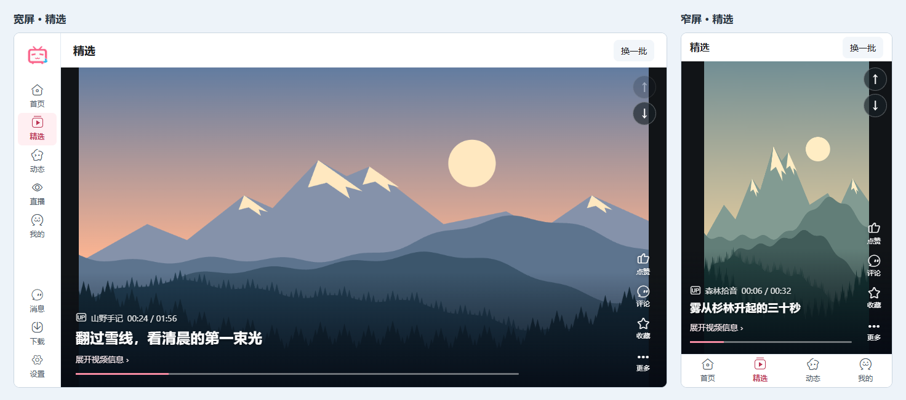

# 精选视频流 · 协议调研与交互设计

2026-11-28，设计提案。BiliSail 源码基线 `925e71c5`。在浏览器打开[宽窄屏交互样式稿](featured-video-feed-preview.html)，可切换横竖素材、展开评论，以及从「我的」或首页头像进入设置。画面为示意插画。

建议增加独立的「精选」一级页。桌面进入即呈现 Windows 精选流，手机进入即呈现 App Story 流。手机首页有 Story 跳转的视频卡还可以从点击的那条开始刷。协议跟随平台与入口，排版跟随窗口可用空间，Windows 缩窄、平板分屏和窗口旋转都能保留当前视频与下一批推荐。

## 1. 桌面精选

取证对象为官方 Windows `1.13.0.3194`，安装包内 `app.asar` SHA-256 为 `11564436e8325adbcab4fd820efed99a48cde897501c7323c4b42678bd95e17b`。渲染包 `render/assets/biliapp.c9829843.js` 的 `/page/selected` 调用 `getHomeRecommands`，公共请求层在 `index.e69ae269.js`。下表按两层合并后的请求整理。[官方客户端下载](https://app.bilibili.com/)

**GET `https://api.bilibili.com/x/web-interface/index/top/feed/rcmd`**。路径中没有 `/wbi/`，但调用明确启用 WBI，公共层生成 `wts/w_rid`。公共 GET 层加入 `web_location=bilibili-electron`，另有 `x-app-version` 请求头。游客可读，登录态设计复用本项目目标域 Web Cookie，无需 App token 或 CSRF。

| 操作 | fresh_idx | fresh_type | 共同参数 |
| --- | ---: | ---: | --- |
| 新开精选 | 1 | 0 | `ps=10`、`plat=1`、`feed_version=CLIENT_SELECTED` |
| 消费完一批前补充 | 2、3… | 4 | 同上 |
| 用户主动换一批 | 重置为 1 | 3 | 同上，下一次续批回到 `fresh_idx=2, fresh_type=4` |

官方调用没有给首页网格的 `x_num/y_num` 传值。精选先从 `data.item` 筛出有 `cid` 的条目，待取用队列少于 3 条时补货。本项目可以按现有视频能力进一步校验 `goto/id/bvid/cid` 和广告标志，读取 `title/pic/owner/stat/duration/track_id`。普通桌面首页的 `/wbi/index/top/feed/rcmd`、`V1`、30 条和独立刷新序号继续用于首页，热门的「入站必刷」也是独立栏目。相邻 bili-kernel 同样识别了 `CLIENT_SELECTED`，其固定首批请求适合作交叉核对，连续分页以官方调用为准。[现有桌面首页](../validation/desktop-recommendation-2026-11-14.md) · [bili-kernel 请求](https://github.com/Richasy/bili-kernel/blob/e26f6dbd071e20d4220806fcff7bd675f3c29fc5/src/Services/Services.Media/Core/VideoDiscoveryClient.cs)

## 2. 手机 Story 与单稿相关推荐

官网下载的国内 Android 包为 `tv.danmaku.bili 9.21.0 (9210300)`，SHA-256 为 `7e42d4ac53c9df36eddf570eb610be63bb089fe4e39b16970d2df307e5f1991a`。核对了 `classes21.dex` 的 `com.bilibili.video.story.api.StoryBiliAppService`、组装查询参数的 `zuk2.b`、请求成功回调 `eum2.onSuccess` 和 `StoryTabViewModel$requestFlow$1` 的相关视频调用。接口声明与点击入口的映射分开判断。同一稿件可以进入多种播放界面。[官方 Android 下载](https://app.bilibili.com/) · [B 站官方对 Story 播放页的场景定义](https://miniapp.bilibili.com/miniprogram-docs/reference/scene-list.html)

| 面向用户的用途 | GET 路径，host 均为 `app.bilibili.com` | 首批与续批 |
| --- | --- | --- |
| 精选根页直接刷 | `/x/v2/feed/index/story`，`getStoryList` | 新流用 `display_id=1`，无需种子。普通成功回调递增，尾部补货发 2、3…；场景也可通过路由提供起始值。 |
| 点首页 Story 卡，或在当前普通 UGC 主动选择「上下滑观看」 | 同一 `/x/v2/feed/index/story` | 首批带种子 `aid`，已有且匹配时带 `cid/bvid` 及卡片上下文。先呈现用户点的稿件与分 P，再追加响应并去重。一个流保留进入时的种子，翻页不把刚刷到的每条都变成新种子。 |
| 明确围绕一条稿件取相关列表 | `/x/v2/feed/index/relate/story`，`getVideoRelatedData` | 请求锚点为 `aid`。样本返回 `meta/items/config`，其中 `meta` 有 `video_num/title_tail`。没有验证跨批游标，首版连续流无需依赖该端点。 |

**Story 参数分三层传递。**

- 批次及种子由本项目控制。`display_id` 是请求构造器中的批次计数，初值 1；`aid/cid/bvid` 来自入口稿件。首页 Pegasus 推荐用的 `idx/flush` 不能直接用作 Story 游标。服务端回显的卡片 `idx` 也不作为下一批序号。
- 官方 `getStoryList` 声明的入口参数包括 `trackid/story_param/pull/request_from/contain/goto/open_event`。注意出站 `trackid` 与响应 `track_id` 拼写不同。还声明了 `epid/ogv_style/creative_id/feed_status/material_no/questionaire_info/need_translate/reply_down_style/room_id`。首版聚焦普通 UGC，只发送有来源、有明确用途的值；本次没有逐个确认整数枚举的场景含义。另有 `/story/refresh`（`id/goto/trackid/scene`），勿把它当成下一批。
- 公共参数构造可见 `access_key/player_net/network/display_id/video_mode` 等，首批分支还写入 `from/from_spmid/spmid/auto_play`。接入时复用本项目 App profile、签名、设备会话与账号校验。游客和只有 Web 凭据的用户可取游客 Story，有可用且匹配的 App 凭据才发送 `access_key`。登录 token 过期或账号切换按现有认证流程处理。服务端广告参数及非本项目入口标识不合成。

`getVideoRelatedData` 另声明 `aid/trackid/spmid/from_spmid/view_attribute/season_id/arc_attribute/need_translate/reply_down_style/goto` 和公共参数表。该方法与通用 Story 方法有不同返回模型。普通详情里若要做「刷这条视频的相关内容」，可单独使用其返回的一批；本提案不假定官方每次点击视频都走这一条。iOS 有第三方实测记录印证该路径，本次没有独立核对 iOS 安装包，iOS 使用兼容 App 协议是本项目设计选择。[iOS 作者的请求记录](https://github.com/UserC23/bilibili-ads-loon)

### 游客只读抽样

同日在 Windows 上向公开接口直接发 GET。桌面组使用动态 WBI 参数与 Electron 的 `web_location`，手机组使用最小查询、普通浏览器 UA 和官网下载页 Referer；没有读取已登录客户端、模拟播放、发送心跳或互动。下表是当次服务端结果，不用于评价账号个性化或证明参数均为必填。

| 请求 | HTTP／业务码 | 原始响应 |
| --- | --- | --- |
| 桌面首次／续批／主动刷新 | 三次均 200／0 | 各 10 条，三批各有 10 条同时具备 BV 和 CID |
| Story 无种子，`display_id=1` | 200／0 | 4 条，`data.items` |
| Story 公开种子 `aid=113350747029965`，`display_id=1` | 200／0 | 5 条，首条是种子 |
| 同种子，`display_id=2` | 200／0 | 4 条，本批未重复种子 |
| 同种子，`relate/story` 附 `display_id=1` | 200／0 | 20 条，本批未包含种子；这次请求不能证明该参数对相关列表生效 |

Story 样本有 `card_goto=vertical_av`、`bvid/param`、`player_args.aid/cid`、`dimension.width/height/rotate`、`cover/owner/stat/duration` 等。抽样卡片的顶层没有 `cid`。因此桌面卡与 Story 卡分别解析，不能照搬首页 App 卡的 `can_play==1` 过滤或仅接受 `av/inline_av_v2`。媒体地址仍由已确认的 BV／CID 走项目分轨解析，横竖取视频尺寸，`vertical_av` 表示卡片业务类型。缺 CID 时可从详情补齐且核对分 P；有歧义时显示重试或跳过，避免播放错误分 P。

## 3. 页面与入口

| 位置 | 建议样式与行为 |
| --- | --- |
| 宽屏侧栏 | 首页 → **精选** → 动态 → 直播 → 我的。消息、下载、设置沿用侧栏工具区。精选采用带播放符号的叠片图标，选中使用主题强调色，完整侧栏与图标文字上下排列两种样式都能辨认。 |
| 窄屏底栏 | **首页 · 精选 · 动态 · 我的**，沿用 52 逻辑像素栏高与系统安全区。直播仍收在首页频道。窄屏「我的」个人资料栏右上放齿轮，游客也能进入。首页头像的账号抽屉在退出登录上方加「设置」；游客点头像仍见登录弹窗，在弹窗增加同一路径的次要「设置」入口。 |
| 导航特例 | 设置仍是 `/settings`。从头像／我的进入时记录来源，返回恢复首页频道或我的原子页；宽屏设置直达保持现行行为。若用户显式选宽屏底栏，可保留原宽屏直播与设置，同时插入精选；窄屏手动侧栏保留原工具区，仍可从「我的」进设置。按现有紧凑归组、栏位偏好分别判断。 |
| 精选根页 | 进入直接显示第一条，根导航保持可见。选中态稳定，普通切回恢复当前条目、位置和手动暂停态。明确的刷新操作才以新批替换；刷新失败仍可继续看原条目。 |
| 手机从视频进入 | 识别可信的 Story 路由／类型，点击后第一帧就是所点稿件；普通 UGC 播放页建议在现有更多菜单增加「上下滑观看」，保留当前 CID 和进度。此临时观看页使用返回键退出到原列表／详情，隐藏根底栏。首页普通卡、多 P、稍后再看等原有点击和队列语义分别保留。 |

首页卡片应保留服务端的 Story 跳转意图，例如 `bilibili://story/<aid>`。本项目 App 卡片解析目前优先识别 `av/inline_av_v2`，导航端对视频统一打开 `/video/…`；仅凭封面长宽推断会把普通竖稿也带入精选。建议在卡片目标中保留「以 Story 打开」及白名单内的入口参数，Web／PC 首页源没有该标识的稿件仍可从普通播放页主动进入。[现有推荐目标映射](../../lib/features/feed/data/api_feed_repository.dart) · [卡片导航](../../lib/features/feed/presentation/feed_video_grid.dart) · [Story URI 行为对照](https://github.com/BiliRoamingX/BiliRoamingX/blob/main/integrations/app/src/main/java/app/revanced/bilibili/patches/BLRoutePatch.kt)

### 同一播放器的宽窄排版

- **宽屏，一屏一条。** 黑色舞台占满内容区，横视频按原比例尽量放大，竖视频居中、两侧留黑。左下叠加 UP 名、最多两行标题和进度；右侧放点赞、评论、收藏、更多；桌面另有上／下一条按钮。评论和简介按需打开约 380 逻辑像素的侧栏，视频在剩余空间重新适配，关闭后原位置继续。无需常驻另一列推荐。点赞等操作复用现有互动权限与状态。
- **窄屏，一屏一条。** 沿用竖屏「收起视频信息」的画面优先布局。竖素材等比展示，横素材完整居中，上下留黑可承载标题与操作；不强制旋转或中心裁切。标题、UP 和进度在安全区及底栏上方，右缘保留评论等触点。打开评论／简介走底部面板，面板列表自行滚动；系统返回优先关闭面板，再退出观看。全屏为显式操作。
- **缩放与无障碍。** 导航沿用现有位置断点（自动默认 600）及完整侧栏断点（默认 1600）；评论呈现使用播放页自身可用宽度与现有左右布局阈值（默认 1000）。因此既能有侧栏加底部评论面板，也能在宽平板用 App 源加右侧评论。上下条、面板关闭均可点击、可聚焦，支持屏幕阅读器；减少动态效果时直接切页。[响应式布局设置](../validation/responsive-layout-settings-2026-11-14.md)
- **输入冲突。** 精选画布内滚轮／触控板纵滚或中央竖滑每次切一条；一次连续惯性滚动在落位前只触发一次。触屏两侧保留项目已有亮度／音量手势，横向拖动和进度条优先进度，中央上下滑在精选中替代普通页的全屏手势；显式全屏可用。鼠标在普通页画面滚轮仍调音量；精选音量由播放器控件调。评论、菜单、编辑框和全屏先接管输入；键盘仅在视频区获得焦点时用 ↑／↓ 切片。不要把翻页挂成全局监听。[现有画面滚轮](../../lib/features/playback/presentation/playback_panel.dart) · [现有触屏分区](../../lib/features/playback/presentation/player_swipe_controls.dart)

## 4. 接入 BiliSail

1. **协议和来源。** 在 `bili_api` 增桌面精选和手机 Story 两个 GET 适配器，分别解析 `data.item` 和 `data.items`。将精确的 Story 读路径及适用的 App 会话 headers 纳入 `requestAppJson` 目的地白名单；桌面走已有 Web/WBI 通道。复用首页推荐的账号隔离、过滤和取消能力，把「精选源」与设置中的「首页推荐来源」独立。桌面家族默认 Windows 协议，Android／iOS 默认 App Story；macOS、Linux 与 iOS 均属拟接入平台。[API 实现](../../packages/bili_api/lib/src/api_client.dart) · [App 推荐](../../packages/bili_api/lib/src/clients/app_recommendation_client.dart) · [身份仓储](../../lib/features/feed/data/app_recommendation_identity_store.dart)
2. **列表和分页。** 新增轻量的精选条目与会话控制器，保存来源、入口种子、批号、当前条目和有界回看窗口。以 BV／CID 做稳定身份去重并保留合法分 P，去广告、直播／剧集／外跳与用户过滤分别处理。剩余 ≤2 条时单飞预取一批，仅拉元数据与邻近封面。建议最多留 60 条、另留 128 个近期身份去重；当前与最近回看优先。首次／追加／刷新各有可重试错误态；连续两批过滤后为空就显示手动继续。失败重试复用原批号，成功才推进；账号、种子或刷新代次变化取消旧请求。遇认证、风控按现有错误策略展示。
3. **路由和播放所有权。** 在固定根工作区增 `/featured` 分支，登记根页识别、返回及栏位选中态。根精选在浏览主窗内播放；桌面双标签浏览不会因滚动一条就新开独立播放窗。当前管理器按 tab ID 持有 session，而首页与精选可能共用固定 tab ID；需让组合根显式标识并激活精选播放 owner，令 `PlaybackManager` 同步活动 owner 后再开声。种子入口来自普通播放页时，同一 owner 切换呈现并保存原详情返回点。切片仅在页面落位后换源，隔离迟到的详情、playurl、弹幕和评论；滚动过渡中的邻页只画封面。离开根精选及时暂停并撤下 surface，回页保留进度。后台、独立窗口互斥和多标签并发遵守现有播放策略。[根分支](../../lib/app/workspace_root_page.dart) · [路由与标签](../../lib/app/workspace_tabs.dart) · [播放仲裁](../../lib/features/playback/application/playback_manager.dart)
4. **播放意图、历史及归因。** 落位后按现有自动播放偏好打开。精选播完后从头循环当前分 P。普通播放页沿用用户保存的播放模式，精选可通过手势或切换命令播放另一条。仅已确认播放的条目进入既有观看历史与心跳。当前 `RecommendationPlaybackContext.fromSpmid` 固定为首页，需改为按可信入口绑定；无确证来源时省略可选归因。滑过封面不会发送播放、曝光或互动写请求。[播放归因类型](../../lib/domain/recommendation_playback_context.dart) · [归因注册表](../../lib/features/playback/application/recommendation_playback_registry.dart)
5. **首版验收顺序。** 先固定两端脱敏 fixture，覆盖批次 1→2、刷新、种子不重复、嵌套 CID、坏卡、空批与账号切换。再用 fake player 验证快速连滑只打开最终落位视频，打开评论、旋转、缩窗、切根页、返回及桌面双窗口时不会双音。最后在 Windows 和 Android 实测鼠标／触控惯性、横竖素材、DASH 音视频分轨、弹幕、历史和后台切换；iOS 与 macOS 需各自做设备验收。登录态个性化、长时间刷流稳定性、媒体性能与真实账号写操作尚无本轮测量。

首版优先打通桌面精选、手机直接 Story、种子进入和四个导航／设置触点。单稿相关列表具备独立接入条件，可在产品确定需要「只看这条的相关推荐」后增加。

本轮浏览器样式稿已检查桌面 380 像素评论侧栏、窄屏底部面板、底栏四项、从「我的」和首页头像打开设置后返回，以及从首页示例稿进入带种子的观看页。样式稿的箭头也供鼠标预览窄屏切片，手机实装可随播放控件隐显。Flutter 应用接入与设备播放验收留待实施阶段。

## Flutter 接入记录

设置 → 推荐流 → 精选视频流来源提供「跟随平台」「桌面端精选接口」「移动端 Story 接口」。跟随平台在 Android、iOS 选择 Story，在桌面选择 Electron 精选。窗口缩放只切换播放布局。首页推荐来源与精选来源可分别保存。

固定根页使用 `/featured`。移动端首页的 Story 卡可进入带种子的 `/story/:bvid`，普通 UGC 播放菜单里的「上下滑观看」复用当前播放标签，带入分 P 和进度，返回时恢复原稿件。评论与视频信息默认收起，按播放区可用宽度打开侧栏或底部面板。根精选只在前台播放，离开后保留进度及手动暂停状态。

底栏模式的精选根页默认显示工作区底栏，可用播放工具栏右下角的四角按钮收起或展开。上下滑动只切换视频，左上角让给当前稿件的播放选项。主工作区使用侧栏时，精选根页和从普通视频进入的种子 Story 都可用四角按钮控制侧栏，与标题栏开关和快捷键共用显隐状态和保存设置。眼睛图标继续控制视频信息和互动叠层，种子 Story 的返回入口沿用原有位置。

本机使用接入后的 Dart 客户端进行游客只读抽样，桌面第 1、2 批各解析出 10 条，移动端第 1、2 批各解析出 5 条，四批条目均有 CID。另一次带种子的 Story 首批解析出 6 条，第一条为入口稿件；续批解析出 5 条，第一条为其他稿件。此结果只覆盖当次公开读请求。登录态个性化、实机连续播放和触控手感仍需分别验收。

## 滑动、播放权与预加载

触屏拖动时卡片跟随手指。慢拖松手后，位移达到视口高度的 16% 即翻页，门槛限制在 48 至 96 个逻辑像素之间。快速轻扫按松手速度和方向翻页，拖回起点附近会回到原卡。开启「减少动态效果」时，松手后直接落位。鼠标滚轮累计 24 个逻辑像素触发一页，常规动画为 220 毫秒。

官方 Windows 客户端 `1.13.0.3194` 的精选页轮换三个卡片槽位。卡片取得 CID 后便请求视频详情，并创建、连接或重载该槽位的 Nano 播放器。初始化使用 `autoplay: false`，当前槽位收到播放指令，离开当前槽位时暂停。同一份渲染代码另有推荐队列少于三条时补充推荐列表的逻辑。检查对象与上文桌面协议取证相同。渲染代码可以确认播放器准备时机，无法据此确定相邻卡片实际缓冲的音视频字节数、首帧耗时或手机端的原生实现。[官方下载中心](https://app.bilibili.com/)

AndroidX Media3 1.4.0 的短视频示例按当前页与邻页的距离预取媒体，卡片绑定已准备的媒体源，使用有数量上限的播放器池。BiliSail 参考了相邻卡片提前准备、落位复用的做法，继续使用现有播放会话和 media_kit。 [ViewPagerMediaAdapter](https://github.com/androidx/media/blob/1.4.0/demos/shortform/src/main/java/androidx/media3/demo/shortform/viewpager/ViewPagerMediaAdapter.kt) · [ViewPagerMediaHolder](https://github.com/androidx/media/blob/1.4.0/demos/shortform/src/main/java/androidx/media3/demo/shortform/viewpager/ViewPagerMediaHolder.kt)

BiliSail 在精选可见并拥有媒体权限时，保留当前、前一条和后一条的详情请求。有 CID 时，详情和原声 DASH 播放地址并行请求。缺 CID 时，只有详情能确定唯一分 P 才预取其地址。上下翻页复用已完成或进行中的请求，落位后仍由当前会话按用户的画质、编码、音轨和 CDN 设置选择媒体。每条视频在自己的卡片内挂载画面。

如果首个 DASH 响应列出了用户选择的画质却未附对应轨道，预开和落位共用一次该画质的补充请求，沿用同一组签名地址。用户在当前视频重试时仍会重新取址。预取的播放地址只存内存。离开精选会释放相邻条目的预取。普通地址预取保留一分钟。备用播放器持有的地址最多保留十分钟，减少观看长视频后重新取址。签名地址临近到期、预取过期或失败时，落位后重新解析。单测覆盖前滑和立即回滑、隐藏时取消、账号切换、请求在途交接、过期回退，以及前台复用同一次 DASH 请求取得音视频双轨。未构建客户端，也未测量实机的滑动至首帧时间。

当前卡片的媒体打开后，沿浏览方向为一个相邻条目预开播放器，并行读取媒体和本地续播位置。前后各一个画面槽位可提前挂载。备用播放器在离屏时解码音视频；卡片露出后确认可见首帧，再按目标条目的播放意图静音播放。拖回原页会暂停预览并恢复其起点。落位后由前台会话接管原画面、弹幕和观看记录。前一个视频先暂停，新视频获得播放权后恢复音量。

前台校验媒体轨道、请求头、起播位置和输出配置。匹配时沿用同一播放器和卡片画面；原生预开尚在进行时，最多在本次打开预算内等待两秒。准备失败、签名临期或使用系统杜比／透传输出时，走正常前台起播。离开精选、切换账号和应用退到后台会释放备用资源。触屏手感、真实网络首帧和设备解码能力仍需实机验证。

精选最多保留最近访问的 8 条播放状态，包括分 P、已解析的媒体、播放位置和播放意图。立即回滑时，优先接回上一条已暂停、静音的播放器。更早的条目可用仍然有效的媒体地址从保留位置打开。账号、地址有效期或播放配置发生变化时，会重新校验媒体。

精选页与全屏跟随设置中的「播放器控件交互」，设置变更即时生效。控件收起时，左下信息卡和右下互动栏距画面底边 12 个逻辑像素。控件出现时，两侧随淡入上移至底栏上方 4 个逻辑像素，章节和高能曲线计入底栏高度。控件收起时，两侧随淡出回落。矮窗口可将互动栏横排，宽度不足以并排时，信息卡放在互动栏上方。300 毫秒内完成的切片不会闪出准备提示，长等待仍有反馈。从其他页面点「精选」会恢复原视频和播放状态。在精选页再次点侧栏或底栏的「精选」才会换一批。滚轮、触摸或普通视图的 ↑／↓ 均可切条。页面顶部给视频留出空间，种子观看页保留返回入口。左下显示 UP 主、粉丝、获赞、关注与标题，右下显示稿件的点赞、投币、收藏、评论和分享数。点击分享会复制当前视频链接。评论和简介支持宽屏侧栏和窄屏面板。面板内的触摸和滚轮只滚动内容，保持导航底栏打开前的显隐状态。双窗口的播放权交接见[多标签播放记录](../validation/multi-tab-playback.md)。
