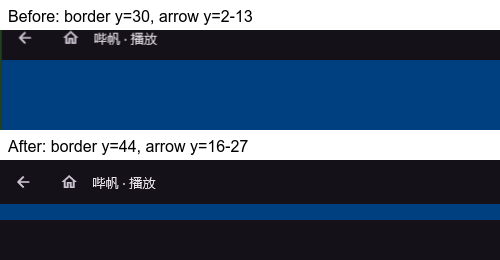

# Windows 双标签播放窗打开性能

日期：2026-10-28。用户反馈 Windows 双标签模式每次点击视频、重新弹出播放窗都有延迟。

## 定位与修改

热点在窗口首帧前，视频详情和媒体下载不参与以下测量。固定 Flutter 3.47.6 的 Windows `FlutterWindowsView::OnWindowSizeChanged` 对已有渲染 surface 的尺寸变化同步等待新帧，最多 100 ms。原来使用固定尺寸 `RegularWindowController`，新 view 尚未挂载 Flutter 内容时，SDK 创建窗口、应用配置自绘标题栏分别触发这段等待。连续重开采样中，创建约 103–105 ms，准备约 101–103 ms，占首显耗时绝大部分。

- [窗口适配](../../lib/core/platform/detached_playback_window.dart)在 Windows 使用 SDK 自带 `RegularWindowController.sizedToContent(resizable: true)`。准备阶段不等待尚不存在的首帧；首帧后 SDK 自动停止内容定尺寸，恢复用户自由缩放。macOS 继续使用原构造方式。没有修改 Flutter SDK、Pub 缓存或播放器依赖。
- 初始内容以恢复后的原生客户区尺寸布局。SDK 按系统标题栏计算外框，而应用使用自绘标题栏；直接切换构造方式会每次重开多加一段标题栏高度。[原生几何适配](../../windows/runner/playback_window_geometry_win32.h)在首显前保留准备好的外框尺寸，首次显示后移除约束。尺寸按值存入窗口 subclass，取消、旧 owner 替换与销毁均清理；保留原有首次可见即最大化的处理。
- 新页面等待其播放 view 准备完成后直接挂载，省去主窗口内隐藏页面的一次创建、布局和跨 view 迁移。只有从单／多标签切换过来的已有页面暂时保留在隐藏区域，沿用原页面、Provider scope 和播放会话。准备期间取消打开的新页面不启动页面工作。
- 视频、PGC、直播和离线播放共用窗口宿主。未增加窗口池、提前初始化播放器或延长已关闭会话的生命周期。

## Profile 测量

[窗口探针](../../tool/validation/windows_playback_open_probe.dart)使用真实 `DesktopPlaybackWindow`、`WorkspacePlaybackWindow` 和视频详情加载态，记录请求、宿主 build、原生创建、prepare、view 首帧和 Win32 `IsWindowVisible`。无账号、网络、媒体解码或观看记录写入。首显以 Dart 发起打开请求至观察到原生窗口可见为准；这不是鼠标硬件事件到画面的完整延迟，也不是视频首个解码帧耗时。

同机 Windows Profile/AOT，普通窗口每组 8 次，第 1 次为该进程首次打开，后 7 次关闭后重开；最大化组预先最大化并关闭一次，再连续重开 8 次。

| 测量 | 修改前 | 优化后首轮 | 最终源码复测 |
| --- | ---: | ---: | ---: |
| 普通窗口重复打开中位数 | 225.53 ms | 19.33 ms | 37.94 ms |
| 普通窗口重复打开范围 | 222.44–227.14 ms | 16.23–21.31 ms | 27.54–50.29 ms |
| 该进程首次打开 | 334.43 ms | 25.17 ms | 48.81 ms |
| 最大化重开范围 | 本轮未采集 | 16.47–20.21 ms | 27.84–63.04 ms |

首轮普通窗口重复打开中位数减少约 91%。最终源码复测同时观察到另一任务的弹幕 GPU 探针进程，未控制其负载，因此同时保留两轮结果，不将该比例视为稳定承诺。最终复测的创建阶段为 2.83–4.28 ms，准备阶段为 0.69–1.04 ms，原来的两段约 100 ms 同步等待已消除；其余首显耗时仍受帧调度和机器负载影响。这是本机受控窗口加载态样本，不推导为所有设备或公网视频的统一加速比例。

两轮普通窗口准备、首次可见和稳定后客户区均为 1120×791 物理像素，连续 8 次未累加高度；最大化首次观察和稳定后均为 1920×1032，准备时保留普通尺寸供用户还原。

可复测入口：

```powershell
./tool/test-windows-playback-open.ps1 -Output build/validation/window-open/normal.json
./tool/test-windows-playback-open.ps1 -Maximized -Output build/validation/window-open/maximized.json
```

输出路径必须未存在；脚本正常结束或失败后恢复普通 Profile 入口。`-SkipBuild` 仅用于已构建该探针的受控对照，不会替换产物。不同任务不要共享同一个 Flutter 构建目录。

本轮因同期弹幕任务使用主工作区 Profile 目录，将当前源码复制到忽略目录 `artifacts/window-open-workspace` 构建。首次共享目录产物被另一个入口覆盖，已弃用该次结果；上述数据全部来自独立副本。副本复用已校验原生下载缓存，保留 TLS 和 CMake/hash 校验。原始记录位于副本的 `build/validation/window-open/baseline.json`、`final-normal.json`、`final-maximized.json`、`final-normal-verified.json` 和 `final-maximized-verified.json`。

## 验证与边界

- 新增组件回归验证新页面只在准备好的 view 创建、准备期间取消不启动页面；现有回归继续覆盖延迟 prepare、合并最新媒体／标题、关闭、退出排空和导航模式迁移。
- `tool/test-window-geometry.ps1` 通过；新增原生回归模拟 SDK 重复添加系统标题栏高度，并验证首显前尺寸稳定、首显后用户缩放和取消后解除约束。既有最大化首显、还原、最小化、全屏、重入取消、旧 owner 隔离和标题栏测试通过。
- 独立副本执行 `tool/check.ps1` 通过：根应用 3187、`bili_api` 495、`bili_player` 83、`bili_danmaku` 95、`bili_mux` 5，共 3865 项通过；根应用 13 项按既有条件跳过，mux 原生 10 项因未设置 `BILI_MUX_LIBRARY` 跳过。五处格式、静态分析和打包边界检查通过，日志为副本的 `build/window-open-full-check.log`。该结果对应捕获的工作区快照，不包含其他任务随后继续修改的代码。
- `windows_playback_test.dart` 原入口在 Debug 运行：6 项通过、2 项失败。失败分别为折叠进度条查找不到，以及 Flutter `LiveTestWidgetsFlutterBinding.handlePointerEvent` 对已关闭 view 执行 `firstWhere` 抛出异常。双窗口用例已走完单会话、跨模式迁移、暂停／进度／倍速保留、用户调整大小、最大化、侧键返回、关闭返回浏览页及最大化连续重开两次的行为断言，但因最后检查到测试绑定异常而失败，不能计作整套通过。日志为 `build/window-open-native-debug.log`。
- `tool/test-windows-main-close.ps1`：无播放时通过，有播放时完成关闭流程后被 `tester.takeException()` 捕获的 `StateError: No element` 阻塞，结果 1 通过、1 失败，日志为 `build/window-open-main-close.log`。在独立副本中临时撤回本次生产改动并恢复原集成测试，重复上述两项测试，分别得到相同的 6 通过／2 失败、1 通过／1 失败及相同失败点；对照日志 `build/window-open-baseline-native-debug.log`、`build/window-open-baseline-main-close.log`。随后恢复优化源码并逐文件核对一致。这些既有失败未扩大到本次性能修复范围。
- 额外的临时 Profile 合并集成入口也未通过，包含 Debug 按键映射不可用、上述控件查找／多 view 事件异常，以及旧 `detached_playback_window_smoke_test.dart` 沿用系统标题栏高度的断言（实际自绘标题栏外框差 16 px，旧断言要求至少 24 px）。该试验日志 `build/window-open-native-playback.log` 保留，不修改无关旧断言。性能结论仅来自独立 Profile 探针，不使用 Debug 帧率。
- 最终源码完成 Windows Profile 构建和普通／最大化各 8 次探针复测，随后重新以 `lib/main.dart` 构建成功，日志为副本的 `build/window-open-ordinary-build.log`。可试用产物在 `artifacts/window-open-workspace/build/windows/x64/runner/Profile/bilisail.exe`，需保留整个 Profile 目录；它是普通应用入口，未遗留测试夹具。未构建 Release 安装包。
- 未验证其他 Windows 机器、Windows 10、跨显示器 DPI、Android/macOS 实机或公网视频加载时间。没有可连接的 Dart 调试应用，无法热重载；原生变更通过重新构建验证。

## 最大化重开时顶部栏闪变（2026-10-31）

**复测状态：用户随后确认跳动仍存在。以下首轮结果只证明 Flutter 首帧布局尺寸已匹配，不证明实际呈现的顶部栏稳定；进一步复查见下一节。**

用户确认仅在最大化播放窗中出现“先低后高”的顶部栏。标题栏组件一直固定为 44 逻辑像素，没有高度动画；问题在首帧布局与首次可见状态不一致：隐藏 HWND 保留普通尺寸，SDK 先渲染普通尺寸的场景，首帧回调才触发原生最大化，随后 Flutter 再渲染最大化尺寸。旧探针连续 8 次记录到首帧标题栏宽度 1120、客户区 1120×791，而首次可见及稳定客户区已是 1920×1032；首次最大化期间会短暂使用旧尺寸的场景。

- 原生恢复几何时，若存在待执行的首次最大化，则返回所在显示器工作区的物理尺寸。Windows 自绘标题栏下，该尺寸等于最大化后的客户区。普通窗口继续沿用准备好的实际客户区。
- Dart 窗口适配器将该尺寸换算为逻辑像素，供初始宽松约束下的场景布局使用。原生窗口仍保持隐藏，首帧回调继续负责首次可见即最大化；普通位置记忆、用户还原、首显后的自由缩放与全屏沿用原处理。
- Profile 探针增加首帧场景、标题栏尺寸和 DPR 记录，并检查首帧场景与稳定客户区一致、标题栏为 44。Windows Profile 最大化重开 8 次，首帧均为 1920×1032、标题栏 1920×44；普通窗口 8 次均为 1120×791、标题栏 1120×44。最终带断言的探针复测两组各 8 次通过，记录在 `build/validation/caption/final-maximized.json` 与 `final-normal.json`，旧实现对照为 `baseline-maximized.json`。这是本机受控窗口加载态验证，不代表公网视频或跨显示器验收。
- `tool/test-window-geometry.ps1` 通过，覆盖首次可见尺寸与自绘客户区一致、普通窗口不使用最大化尺寸、取消后清理，以及既有最大化／还原／缩放／全屏／旧 owner 隔离。窗口服务、独立窗口生命周期、顶部栏和工作区播放窗口的 54 项定向测试通过，日志为 `build/caption-targeted-tests.log`。
- `tool/check.ps1 -SkipPub` 通过：根应用 3681、API 497、播放器 101、弹幕 136、封装包 5，共 4420 项通过。根应用 13 项按既有条件跳过，mux 10 项原生用例因未配置 `BILI_MUX_LIBRARY` 跳过；格式、静态分析和打包边界检查通过，日志为 `build/caption-full-check.log`。最终改动文件另行静态分析通过。
- Windows mux 资产重新构建成功；探针执行后已重新构建普通 `lib/main.dart` 的 Windows Profile 和 Release，未遗留探针入口。日志为 `build/caption-ordinary-profile-build.log` 和 `build/caption-ordinary-release-build.log`；可试用入口为 `build/windows/x64/runner/Release/bilisail.exe`，需保留整个 Release 目录。没有可连接的 DTD／调试应用，本轮通过重新构建验证；未测试跨显示器 DPI、Windows 10、真实账号或公网视频，Android/macOS 未构建或实机验证。

## 顶部栏仍跳动的复查（2026-10-31）

**本节保留尚未取得过渡帧时的分析；后续像素对照否定了“只调整原生几何即可解决”的假设，最终结论与修复见下一节。**

用户补充：文字和按钮大小不变，栏高变大时按钮整排向下移动。这更符合顶部内容的垂直偏移／裁切，不支持将现象直接解释为整帧缩放。当前运行的安装包 `data/app.so` 已包含首轮新增的尺寸校验错误字符串，不能归因于完全未包含首轮 Dart 修改的旧包。

在 `0a91cba` 的隔离 worktree `artifacts/caption-analysis-workspace` 中，增加原生窗口消息记录，并使用无账号、无网络的 Profile 加载态探针。本轮未修改主工作区生产代码，未替换已有 Release 目录或正在运行的安装版。以下是取证结果，而非再次修复成功的结论：

- Flutter 标题栏始终为 44 逻辑像素。首轮保留的 8 次最大化探针，以及本轮原始流程、延后显示和提前调整子窗口的对照，首帧与稳定场景均为 1920×1032、标题栏均为 1920×44、DPR 为 1。没有发现 Flutter 顶部栏自身发生高度动画。
- 首轮只通过 `SizedBox` 预设场景大小。原生加载态仍为 1120×791：父 HWND 已经可见且最大化时，子 HWND 随后才在 `WM_SIZE` 中从 1120×791 调整到 1920×1032。这一可见阶段的几何切换未被首轮探针的“第一帧等于稳定帧”断言覆盖。
- Windows 自绘边框在普通状态将客户区扩展至外框顶边；最大化时必须保留本机 8 物理像素的顶边框 inset，使外框 top=-8、客户区 top=0。顶部内容先被偏移／裁切、随后恢复，与用户反馈相符，但本轮没有捕获到实际跳动帧，不能把具体的 8 像素可见裁切写成已证实事实。客户区计算的系统语义见 [WM_NCCALCSIZE](https://learn.microsoft.com/en-us/windows/win32/winmsg/wm-nccalcsize)。
- `InitialShowMaximizer` 在 SDK 的 `ShowWindow(SW_SHOWNORMAL)` 尚未返回时，于 `WM_WINDOWPOSCHANGED` 内嵌套调用 `ShowWindow(SW_MAXIMIZE)`。原始流程在首次可见阶段收到两次 `WM_SIZE(SIZE_MAXIMIZED)`；将首次最大化排入后续原生消息后，普通尺寸通知全部在隐藏状态完成，首次可见阶段只剩一次最大化尺寸通知。两种流程最终几何相同，不能仅凭消息数量认定视觉问题已消除。
- 另一对照在首次绘制前就将原生子 HWND 调整为 1920×1032；其 prepared、visible、settled 三个阶段的 view 尺寸均一致，消除了可见后的子窗口尺寸调整。原流程和此对照的 Flutter 标题栏高度均为 44，进一步说明首轮布局检查不能代替像素验收。

原始记录位于该隔离目录的 `caption-nested-trace.log`／`caption-nested-probe.json`、`caption-deferred-trace.log`／`caption-deferred-probe.json`、`caption-presized-trace.log`／`caption-presized-probe.json`。在原生显示后暂停的诊断截图中看到稳定 44 像素标题栏；在窗口过程内部阻塞的截图未获得可用的顶部栏画面，均不能当作已捕获用户描述的过渡帧。

目前最有证据支持的排查方向是首次最大化期间的原生客户区／子窗口呈现时序，而非 Dart 标题栏高度。后续修正应让首次可见前的原生子窗口尺寸、顶边 inset 和场景一致，并消除显示回调中的嵌套窗口呈现；仍须在实际播放页验证顶部边界与按钮屏幕位置的过渡帧。本轮仅完成分析及隔离对照，没有提交新的生产修复，也未重新宣称视觉问题已解决。

## 实际呈现取证与最终修复（2026-10-31）

本轮捕获到问题帧：旧流程顶部栏下边界先在屏幕 y=30，随后回到 y=44；返回箭头的可见像素从 y=2–13 移至 y=16–27，字形没有缩放。Flutter 布局始终为 44，原生最终客户区也正确，但 **DWM 在窗口首次最大化显示时执行的过渡仍会临时偏移／裁切自绘顶部内容**。因此首轮只预设 Flutter 场景尺寸，无法消除实际画面的跳动；8 像素顶边 inset 的早期假设也不能解释已捕获的 14 像素位移。

在隔离 worktree 中用相同窗口宿主做单变量对照：提前设置子窗口尺寸并延后最大化仍跳动；仅设置该播放窗禁用 DWM 过渡后不再跳动。[最终实现](../../windows/runner/playback_window_first_show.h)只对准备以最大化状态首次显示的隐藏播放窗设置 `DWMWA_TRANSITIONS_FORCEDISABLED`。显示完成后投递原生消息，离开首次显示的窗口过程调用栈，再通过 `DwmFlush()` 等待待提交画面呈现并恢复窗口过渡。普通窗口及后续窗口动画沿用原行为，没有修改系统全局动画设置。API 语义见 [Microsoft 的逐窗口过渡说明](https://devblogs.microsoft.com/oldnewthing/20121003-00/?p=6423/)和 [DwmFlush](https://learn.microsoft.com/en-us/windows/win32/api/dwmapi/nf-dwmapi-dwmflush)。

过渡控制与窗口 owner 一起持有；取消打开、owner 替换、窗口销毁均清理，旧 owner 排队的恢复消息不能解除新 owner 的控制。回调只保存 owner 值，不引用可能被重入关闭释放的对象。

### 屏幕画面验收

本机 Windows x64、Profile/AOT、DPR=1、最大化客户区 1920×1032。使用 DXGI Desktop Duplication 录制屏幕顶部 1920×160，FFV1 无损编码，采集配置为 120 fps。实际编码为可变帧率；分析按原始帧 PTS 分组，使用 `-fps_mode passthrough` 解码并核对编码／解码帧数，不把 CFR 补帧计为独立证据。每组先普通打开、最大化、关闭作预热，再连续最大化重开 8 次，预热不计入下表。下边界在 x=120、500、1000、1800 四列测量，箭头同时检查上下边界。

| 对照 | 重开次数 | 捕获的可见帧 | 边界或按钮位置异常的帧 |
| --- | ---: | ---: | ---: |
| 修复前流程 | 8 | 376 | 116 |
| 提前设置子窗口尺寸并延后最大化 | 8 | 380 | 117 |
| 禁用该播放窗 DWM 过渡的诊断对照 | 8 | 411 | 0 |
| 最终代码，首次呈现后恢复过渡 | 8 | 380 | 0 |
| 最终代码，真实音视频播放 | 8 | 511 | 0 |

最后一组使用真实 `PlaybackPanel`、`MediaKitEngine` 和仓库本地分轨 `video.mp4`／`audio.m4a`，每次均确认音频和视频已解码，并等待原生会话关闭后再重开；无网络、账号或观看记录写入。仅在原有顶部栏下增加 16 像素蓝色测量条，未替换顶部栏组件。8 次重开的首个及随后所有捕获到的可见帧，下边界均为 y=44、箭头均为 y=16–27。测试期间诊断窗口保持前台；被遮挡和产物不匹配的试验不纳入结果。

逐次结果见 [像素数据](data/windows-maximized-caption-2026-10-31.json)，代表帧见下图。完整录像、逐帧坐标和解码探针留在忽略目录 `artifacts/caption-analysis-workspace/pixels/`，包括 `baseline.mkv`、`presize-deferred.mkv`、`no-transition.mkv`、`scoped-fix.mkv`、`native-playback-final.mkv` 及同名 JSON；分析脚本为该 worktree 内的 `analyze_caption.py` 和 `write_caption_evidence.py`。



### 回归与交付

- `tool/test-window-geometry.ps1` 通过。新增原生回归覆盖恢复必须排队、呈现后解除控制、取消清理及旧 owner 消息隔离，既有首次最大化、还原、最小化、全屏与重入关闭回归保留。
- `tool/check.ps1 -SkipPub` 通过：根应用 3752、API 499、播放器 105、弹幕 145、封装包 5，共 4506 项通过。根应用 13 项按既有条件跳过；mux 原生 10 项因未配置 `BILI_MUX_LIBRARY` 跳过，不计作原生通过。格式、静态分析和打包边界检查通过，日志为 `build/caption-dwm-full-check.log`。
- 普通入口 `lib/main.dart` 的 Windows Release 重新构建通过，日志为 `build/caption-dwm-release-build.log`；产物为 `build/windows/x64/runner/Release/bilisail.exe`，需保留完整 Release 目录。已核对录屏所用 Profile 原生头文件与生产源码一致，并核对 Release 包含新的恢复消息。没有替换正在运行的安装版。
- 本轮确认范围为本机受控加载态及真实本地音视频播放的最大化重开；屏幕采集不保证覆盖每次物理刷新。未做 Windows 10、其他硬件、跨显示器 DPI、公网视频／账号流程或 Android/macOS 实机验收。原生代码通过重新构建验证。
