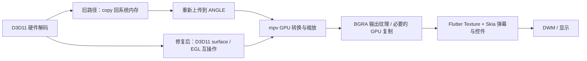

# Windows ANGLE：修复 copy 硬解回退及性能对照

日期：2026-11-01。应用基线 `a4de912`，Flutter 3.47.6／Dart 3.13.5。本轮按用户后续要求，聚焦修复 Windows 的 `d3d11va-copy` 回退并测量性能。弹幕配置和绘制代码保持原样；未实施硬解设置、严格回退策略、DXGI 或其他平台迁移。

## 结论与根因

当前 Windows ANGLE 路径可以使用非 copy 的 D3D11VA，不必更换整个 Flutter 播放器或改为 DXGI。换用包含 EGL 扩展检测修复的完整 libmpv SDK 后，本机 RTX 4070 Ti SUPER 的实际解码器由 **`d3d11va-copy` 变为 `d3d11va`**。H.264、HEVC、AV1 分轨自动播放均确认此结果，显式软件模式仍为 `no`。

三组 AB／BA／AB Profile 对照中，密集弹幕阶段进程 3D 均值 **12.04% → 3.87%**，进程 CPU **610 → 308 ms/s**；整卡功耗 **18.56 → 16.83 W**，核心频率 **384 → 233 MHz**。收益不是仅靠频率升高造成的占用下降。所有稳态阶段视频／解码掉帧计数均为 0。单帧 Flutter raster 时长基本持平，工作集内存增加约 33 MiB；这是整份原生库升级的结果，不能全部归因于单条补丁。

**统计口径澄清（同日用户反馈后补充）**：上述 1.10%／3.87%／3.70% 是指定 BiliSail PID 的短时稳态均值，不是任务管理器“性能 → GPU → 3D”的整卡曲线，也不是峰值上限。原采样脚本只保存该 PID，未记录整卡或 `dwm.exe` 的 3D，不能用这组数据证明普通 Release 真实播放时整卡占用低于 5%，或反驳用户观察到的 10～20%。Windows 性能页汇总所有进程，见 [Microsoft 对统计口径的说明](https://devblogs.microsoft.com/directx/gpus-in-the-task-manager/)。其中 DWM 的开销也可能由本应用的窗口呈现引起，不能将进程之外的全部负载认定为无关程序。

原因是旧 libmpv `43b14a4c9` 的 `video/out/opengl/hwdec_d3d11egl.c` 只在 **display extensions** 查找 `EGL_EXT_device_query`，而当前 ANGLE 将该扩展放在 **client extensions**。此前的 [EGL 查询](data/hardware-decoding-egl-2026-11-01.json)已确认 client 有、display 无，符合误拒绝互操作的条件。mpv [上游修复 `1d15686142fd5d53c954aab7526cedab05ef9dc3`](https://github.com/mpv-player/mpv/commit/1d15686142fd5d53c954aab7526cedab05ef9dc3)同时认可两处扩展。仅修改 `hwdec` 字符串或 Dart 插件无法修复 DLL 内的检测。

本次候选为固定的 [zhongfly LGPL x86_64 SDK](https://github.com/zhongfly/mpv-winbuild/releases/tag/2026-10-12-88eb9f2e73)，mpv 源码 `88eb9f2e73945d8bc9c133a2f67babaa9af34680`，包含上述修复。实际加载后查询得到：

- `mpv-version`: `mpv v0.41.0-1150-g88eb9f2e7`。
- `ffmpeg-version`: `N-127388-g615b07170`。
- `mpv-configuration` 包含 `-Dgpl=false`、`-Dlibmpv=true`、`-Degl-angle=enabled`。完整本地查询结果保留于 `build/windows-direct-hwdec-library.txt`，未读取用户配置或打开媒体。

没有单独重建“旧版本仅加该补丁”的 DLL，因此性能数值属于整个 SDK A/B。源码缺陷、扩展条件、实际 decoder 三者支持回退修复的判断；本轮未使用 ETW／GPUView 检查每次内存传输，不能据此宣称完整链路零复制。

## 与 PiliPlus 的实际链路差异

只读核对相邻 PiliPlus 当前提交 `265f879fa85973b4bf885bde2562f1007f1013b8`，没有修改相邻仓库。其当前视频锁文件已从早期记录的 `fd8421d…` 改为 `85f0a69ea66b100882b27a3375c72e5155375343`；[该提交](https://github.com/bggRGjQaUbCoE/media-kit/commit/85f0a69ea66b100882b27a3375c72e5155375343)只修改 Linux `texture_gl.cc`，Windows 仍是原 ANGLE 实现。

| 环节 | PiliPlus 当前源码／锁文件 | BiliSail 基线与本轮结果 |
| --- | --- | --- |
| 播放核心 | My-Responsitories `73771ec38176be2d984a3049c28177bce23b54a0`，单 mpv player | 相同提交；会话、分轨请求头、音频准备与 source generation 由本应用持有 |
| 解码选择 | Windows 默认 `hwdec=auto`，用户可另选模式 | SDK 默认同为 `auto`；本轮不改参数、自动／软件偏好或持久化 |
| 解码二进制 | Windows 库插件固定 `20260607 / 43b14a4` | 基线相同，本机实际 copy；候选改为含 EGL 修复的 `88eb9f2e73`，实际非 copy |
| 视频输出 | 标准 libmpv OpenGL render API → ANGLE → D3D11 BGRA 纹理 | 同一输出 API；沿用已有借用 ANGLE device、有序提交、按视频修订复制及视口上限补丁 |
| GPU 交付 | ANGLE 输出共享 handle，再经 Flutter Texture 消费 | 本机日志两版均为 `GPU delivery: copied`；这个 GPU 纹理复制与 decoder 的 CPU 回读是两个环节 |
| 视频 Widget | `SimpleVideo`，`FittedBox` 与 `Texture`，默认 `FilterQuality.low` | `Video`，关闭库自带控制层；最终同为 `Texture`，保留现有首帧／尺寸／surface 生命周期 |
| 弹幕 | `canvas_danmaku 275046d…`，滚动／固定分层、显示刷新率 Ticker | 相同库来源，应用自己的有界调度、时钟和缓存；本轮完全不改弹幕路径 |
| 最终合成 | Windows runner 关闭 Impeller，使用 Skia，Flutter 合成后交给 DWM | 当前已同为 Skia；没有新开原生视频窗口或使用独立系统视频 plane |

PiliPlus 的默认配置或枚举列表不能证明它在所有设备／视频上的实际 decoder。本轮没有运行完整 PiliPlus 整应用 A/B，也没有读取该应用此次的 `hwdec-current`；不能把本机 BiliSail 基线的 copy 实值直接当作 PiliPlus 的实测结果。

以下图只表达数据所在位置及组件职责，不是 ETW 抓到的每次 API 调用：



因此，这次实现的是**避免 decoder 的 CPU 回读**。GPU 色彩转换、缩放、纹理交付和 Flutter 最终合成依然存在。`GPU delivery: copied` 不代表修复失败，`d3d11va` 也不代表 3D／Copy 引擎应该为零。

已有可选 trace 显示，整个每次约 40 秒流程的 `Render()` 调用，基线为 2376～2382 次，候选为 2399～2401 次，接近视频的 60fps，而不是滚动弹幕的约 165fps。这是方法调用计数，不是所有内部 GPU draw call；resize 内部重画不计入该字段。本轮证据不支持把差距归因为弹幕每次刷新都重新解码／渲染一次视频，因此保留原队列、强制重画及生命周期代码。

## 资产接入与边界

[唯一现行清单](../../windows/native/media-assets.cmake)同时供 [预取脚本](../../tool/prepare-windows-media-assets.ps1)、Windows CMake 编译和最终 bundle 使用：

1. 上游库插件／事件桥继续注册，原上游 libmpv 和 ANGLE 归档仍校验 SHA-256。插件自身原有的 MD5 也继续执行。
2. 候选 SDK 先校验归档 SHA-256，解压到其归档 SHA 命名的独立构建目录。DLL、import library 和四份头文件逐一校验，拒绝不完整、旧版本或混合 SDK。
3. 在已核实的插件 target 上，成套选择候选 headers／import library／DLL；最终 bundle 列表移除旧 DLL，安装前再次校验选中的 DLL。上游 target 契约变化则停止构建。
4. 来源、LGPL 原文及清单安装到 `data/licenses/mpv`。不启用旧 `windows/native/mpv.cmake`，不修改 Pub 缓存，不使用 DXGI 私有扩展或 x86-64-v3 资产。对应 [SOURCE.md](../../windows/native/mpv/SOURCE.md)记录精确来源、构建材料与分发边界。

Windows Dart 包及两份锁文件没有变化。其他平台的库插件、Android Surface、Apple CocoaPods 与 Linux 输出均不变。自动模式仍允许设备／编码不支持时回退；本次没有实现方案中的“仅直通”设置或失败提示，不对未知设备伪造已直通状态。

## 三组 Profile 对照

使用生产 [PlaybackPanel 探针](../../tool/validation/playback_gpu_comparison_probe.dart)与现有 [GPU 采样脚本](../../tool/test-windows-gpu-playback.ps1)。本地合成 H.264／AAC，1920×1080、60fps；相同文件 SHA-256 `9308fedd5bbf195619c43719ea39a2313d48c8444e60b63f1087016405a3b584`。无账号、网络请求或用户设置落盘，音量 0。

- 硬件：RTX 4070 Ti SUPER，驱动 617.42；Windows Profile、Skia、原 ANGLE、DPR 1。GPU 进程计数样本只有一个 adapter。请求 1600×900，但工作区限制后的实际输出为 **1216×684**，所有成功阶段一致，不能写成全屏／4K 测量。
- 每轮：纯视频预热 4 秒、稳态 10 秒；seek 至同一 10 秒位置，弹幕预热 5 秒、稳态 10 秒；显示控件后预热 1 秒、稳态 10 秒；最后暂停 3 秒。
- 弹幕：每秒 20 条，80% 滚动＋20% 顶／底固定；原字号、区域、效果及整体不透明度 0.8。约 63 条同屏，显示控件后约 60 条。
- 顺序：`base_a → direct_a → direct_b → base_b → base_c → direct_c`，三组 AB／BA／AB。采样期间没有本任务的构建／测试并行。GPU 未锁频，桌面非独占。
- 两份完整 bundle 的 AOT `data/app.so`、runner、Flutter engine 和两份 ANGLE DLL 的 SHA-256 分别完全相同；只改变所选原生 SDK及其插件重新链接。各文件摘要保留在[机器可读结果](data/windows-angle-direct-hwdec-2026-11-01.json)。
- GPU Engine 取对应进程、适配器和稳态区间；CPU 是进程所有线程累计消耗，单位 ms/s，1000 ms/s 等于一个逻辑核持续忙碌。功耗和频率是整卡数据，不是进程独占值。

下表为每轮均值的三轮平均值：

| 场景 | 进程 3D %，copy → direct | 进程 CPU ms/s | 整卡功耗 W | 核心 MHz | 工作集 MiB |
| --- | ---: | ---: | ---: | ---: | ---: |
| 纯视频 | 12.16 → 1.10 | 551 → 129 | 16.36 → 15.54 | 308 → 252 | 324 → 367 |
| 密集弹幕 | 12.04 → 3.87 | 610 → 308 | 18.56 → 16.83 | 384 → 233 | 352 → 385 |
| 密集弹幕＋控件 | 10.81 → 3.70 | 585 → 344 | 21.27 → 16.65 | 564 → 218 | 365 → 395 |

密集弹幕的每轮 3D 为 `12.69 / 11.78 / 11.65%` → `4.76 / 3.57 / 3.27%`，CPU 与整卡功耗也同向下降。控件阶段基线 A 有一次频率／功耗升高，三轮结果和频率均完整保留，不能据整卡均值宣称本应用单独节电多少。

| 场景 | UI 均值 µs | raster 均值 µs | raster P95 µs（三轮 P95 平均） | Dart 计帧／秒 |
| --- | ---: | ---: | ---: | ---: |
| 纯视频 | 161 → 160 | 333 → 339 | 504 → 523 | 61.37 → 60.20 |
| 密集弹幕 | 224 → 220 | 553 → 547 | 914 → 900 | 173.27 → 164.97 |
| 密集弹幕＋控件 | 223 → 226 | 585 → 591 | 964 → 973 | 175.00 → 165.13 |

Dart 计帧不是视频的解码或屏幕实际呈现帧率。没有改变 Ticker、刷新率设置或主动限帧；实测两版的 Dart 调度仍有约 5～6% 差别，应结合这一差别和 GPU 动态频率解释占用数据，不能把 3D 百分比的降幅直接称为渲染效率提升比例。Flutter 单帧耗时基本持平，收益主要在原生解码／传输链路。

18 个稳态阶段的视频与解码掉帧计数均为 0，最大上报 A/V 差绝对值为 0.914ms。自动化以静音素材验证轨道、时钟及画面，不能替代人工听音同步验收。候选工作集增加约 30～43 MiB，没有做长时间内存稳定性测量。

原始 JSONL、日志、时钟 CSV 和完整 bundle 均在忽略目录 `build/validation/`，标签为上面的六个 `hwdec_*_20261101`。新的[汇总脚本](../../tool/validation/summarize_windows_hwdec.ps1)检查三组输入、输出尺寸、实际 decoder、AOT／引擎／ANGLE 摘要及足够的 GPU／时钟样本，拒绝不匹配的数据。

```powershell
# 修改前后分别构建并保存完整 Profile 目录，标签必须唯一。
$env:BILISAIL_VIDEO_RENDER_TRACE = '1'
flutter build windows --profile --no-pub -t tool/validation/playback_gpu_comparison_probe.dart
$env:BILI_GPU_MODE = 'mixed'
$env:BILI_GPU_SIZE = '1600'
./tool/test-windows-gpu-playback.ps1 -Label <新标签> -Seconds 10 `
  -ExePath <完整bundle>/bilisail.exe -MediaPath <本地1080p60素材>
# 完成三组有效对照后汇总，保留已有报告。
./tool/validation/summarize_windows_hwdec.ps1 `
  -BeforeLabels <旧A>,<旧B>,<旧C> -AfterLabels <新A>,<新B>,<新C> `
  -OutputPath <新JSON路径>
Remove-Item Env:BILISAIL_VIDEO_RENDER_TRACE, Env:BILI_GPU_MODE, Env:BILI_GPU_SIZE -ErrorAction SilentlyContinue
```

## 验证与未测项

- `tool/check.ps1 -SkipPub` 通过格式、分析、打包边界与根／四包离线测试：根 3922、API 540、player 131、danmaku 153、mux 5，共 **4751 项通过**。根应用 13 项条件跳过；mux 原生 10 项因未配置 `BILI_MUX_LIBRARY` 跳过，不计为原生封装通过。日志 `build/windows-direct-hwdec-check.log`。
- [原生资产回归](../../tool/test-windows-media-assets.ps1)七项通过：完整 SDK 可用，旧 DLL 混入、缺 import library、头文件被改及缓存归档被改均拒绝；本地受控下载校验通过后才发布，错误摘要不发布目标文件。日志 `build/windows-direct-hwdec-assets.log`。
- `tool/test-windows-codecs.ps1` 通过一个集成用例内的六组分轨播放：H.264／HEVC／AV1 自动模式全部 `d3d11va`，三种软件模式全部 `no`，均确认音视频解码、进度推进、暂停、seek 和停止。素材为 256×144；不能以此代表 Main10、4K／HDR。日志 `build/windows-direct-hwdec-codecs.log`。
- Windows 原生集成共 **39 项通过**：`test-windows-media.ps1` 33 项、`test-windows-content.ps1` 4 项、上述 codecs 1 项及 resize 1 项，覆盖 DASH／外部音频、暂停／seek／倍速、重播、首帧、音频模式、系统媒体控制、截断／暂时断流、预览缓冲及直播等待恢复。resize 实读 `sameSurface=true`、`sameTexture=true`、`pixels=true`、`pausedAndPlaying=true`。日志为 `build/windows-direct-hwdec-{media,content,codecs,resize}.log`。
- `test-windows-video-dispose.ps1` 的 9 项 C++ 生命周期／队列／尺寸回归通过；`test-windows-gpu-queue.ps1` 的两份原生可执行测试通过，检查 100 帧同设备交付、保护性复制、共享 EGL display、稳定纹理 ID、描述符租约和 resize 回退。日志为 `build/windows-direct-hwdec-{dispose,gpu-queue}.log`。
- 修改前后 Windows Profile 构建及六次生产面板对照完成。没有 Dart 产品代码改动，本轮原生库通过重新构建／启动验证。
- Windows mux 组件构建与普通 `lib/main.dart` 的 **Release 构建通过**，最终入口为 `build/windows/x64/runner/Release/bilisail.exe`，运行／分发需保留整个 Release 目录。最终 DLL SHA-256 与清单一致，事件桥、Vulkan loader、mux、来源／许可／清单均在 bundle 内；没有把性能探针留作普通入口。日志 `build/windows-direct-hwdec-{mux-build,release}.log`。未执行安装或普通账号启动验收。

本机结论不能外推至 AMD 780M、Intel UHD 770、混合显卡或其他驱动。4K、HEVC Main10／HDR、1×以外倍速、直播 GPU、真实网络、完整 PiliPlus 整应用对照、设备丢失、长时间播放与安装升级尚未验收；Android／Apple／Linux 未在本轮变更或验证。硬解方案其余阶段仍保留原来的设备门槛。

## 用户反馈的整卡 10～20% 与现有数据的关系

用户明确指的是任务管理器性能页的整卡 3D。复核原始六次 JSONL 后，确实每次只包含一个 BiliSail PID；修复后密集弹幕阶段每轮只有 6～7 个有效 GPU 计数点，三轮均值分别为 4.76%／3.57%／3.27%，单个采样点最高 6.27%。保留原始数据和表格，但不将其扩展成普通 Release 或整卡结论。

本轮额外只读核对了正在运行的 `build/windows/x64/runner/Release/bilisail.exe`：该进程实际加载的 libmpv SHA-256 为 `222da57d12a47680df84a8d0ad06f713fbbce4da923784ddeebe9d666135e943`，与候选一致。随后按物理 3D engine 同时采集目标 PID、DWM 及其他进程 20 秒；该时间段目标进程的 3D 为零，没有捕获用户描述的播放负载，不能把它当作有效复现或判断此前反馈的解码状态。原始审计仅保留在本地 `build/validation/windows-release-whole-gpu-audit-20261101-2664.json`。

需要在相同视频片段、实际清晰度／输出尺寸、倍速及窗口状态下，同步核对应用进程、DWM 和整卡 3D 才能解释真实差额。原受控测试输出只有 1216×684，单阶段稳态采样 10 秒，并排除打开／seek 预热；这些条件与用户真实播放尚未对齐。当前可以确认受控场景的实际 decoder 和进程成本改善，不能宣称用户所观察的整卡 3D 问题已经解决。
